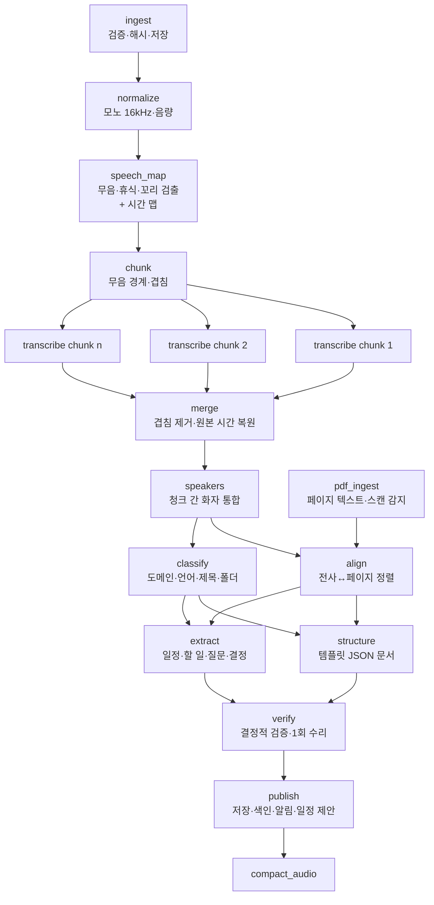

# Lectern v2 — AI 워커 하네스

> 상태: 설계 초안 (2026-10-19) · 관련: [ARCHITECTURE.md](ARCHITECTURE.md), [ROADMAP.md](ROADMAP.md) (P1)

녹음(+PDF)을 받아 전사, 구조화 문서, 일정·할 일·질문을 만든다. 현재는 `distillLectureAudio()`가 오디오를 Gemini에 올리고 **한 번의 호출로 Markdown을 받는다.** 이 방식의 한계는 다음과 같다.
- 전사 데이터가 없다. 동기화도 검색도 근거 연결도 할 수 없다.
- 결과를 검증하지 않는다. 타임스탬프나 날짜가 틀려도 그대로 저장된다.
- 문서 형식만 바꾸고 싶어도 오디오를 다시 보내야 해서 비용이 다시 든다.
- 긴 녹음은 출력 토큰 한도에 걸리고 시간 표기가 밀린다.
- 실패하면 처음부터 다시 한다.

v2 하네스는 이를 **단계형 파이프라인 + 영속 작업 큐 + 결정적 검증 + 비용 원장**으로 바꾼다.

## 1. 원칙

1. **오디오는 한 번만 전사한다.** 그다음 단계는 모두 압축된 텍스트 전사로 일한다. 문서 형식이나 템플릿을 바꿔도 재전사하지 않는다.
2. **모든 산출물에는 출처가 있다.** 문서 블록, 일정, 질문은 세그먼트 ID(시간 구간)나 PDF 페이지를 가리킨다. 출처가 확인되지 않는 항목은 버리거나 "낮은 신뢰"로 표시한다.
3. **모델은 구조를 내고, 표현은 코드가 만든다.** 모델 출력은 JSON 스키마로 제한하고 Markdown/HTML은 결정적 렌더러가 만든다. 형식이 일관된 이유가 여기 있다.
4. **검증은 코드로 한다.** 스키마, 참조, 날짜, 근거를 결정적으로 검사한다. 실패하면 오류를 넣어 1회 수리하고, 그래도 안 되면 그 항목만 버린다. LLM 판정(judge)은 평가에서만 쓰고 운영 경로에는 넣지 않는다.
5. **모든 단계는 재개 가능하다.** 단계 결과를 저장한 다음에 상태를 바꾼다. 어느 지점에서 죽어도 마지막으로 끝난 단계부터 다시 시작한다.
6. **비용은 측정한다.** 모든 모델 호출을 `ai_call`에 기록하고(토큰, 캐시, 금액, 지연), 녹음과 워크스페이스 단위로 합산한다. 모델·라우팅 결정은 평가로 한다.

## 2. 파이프라인 개요



- PDF 처리는 오디오 처리와 병렬로 돌아간다. `transcribe`도 청크마다 병렬이다(공급자 동시성 상한 안에서).
- 단계 하나는 `stage_run` 하나이고 입력·출력은 `artifact`(블롭 + 해시)로 주고받는다. 사용자가 "문서 다시 만들기(다른 템플릿)"를 누르면 `classify`(필요하면)와 `structure` 이후만 새로 돈다.

## 3. 단계 상세

### 3.1 ingest · normalize
- `ingest`: ffprobe로 형식, 길이, 채널, `creation_time`을 읽는다. sha256으로 중복을 감지한다(같은 워크스페이스에 같은 파일이 있으면 기존 녹음으로 연결). `recorded_at`은 클라이언트 값 → 미디어 메타데이터 → 업로드 시각 순으로 정하고, 출처를 기록한다.
- `normalize`: ffmpeg로 모노, 16kHz, 라우드니스 정규화(`loudnorm`)를 하고 전사용 Opus/AAC 저비트레이트 파일을 만든다. 업로드 크기와 공급자 전송 시간을 줄인다. 원본은 보존 정책에 따른다(압축 단계는 기존 storage.ts).
- 사전 거부: 최대 음량이 -60dBFS 이하인 무음 파일은 기존 로직을 유지하되, **전체 길이를 표본 추출해 판정**한다. 지금처럼 앞 5분만 보지 않는다. 길이 0, 손상, 지원하지 않는 코덱도 여기서 거른다.

### 3.2 speech_map — 무음·휴식 검출과 시간 맵
- ffmpeg `silencedetect`(또는 WebRTC VAD)로 발화 구간을 만든다. 그 위에서 결정적 규칙으로 판정한다.
  - **휴식**: 5분 이상 발화 밀도가 낮은 구간
  - **녹음 종료 후 꼬리**: 마지막 발화 뒤 긴 무음이나 잡음
  - **짧은 공백**: 2초 미만, 유지
- 판정된 긴 구간을 잘라 낸 "발화 전용 오디오"와 **시간 맵**을 만든다. 시간 맵은 `[{cut_start_ms, orig_start_ms, length_ms}]` 형태다. 잘라 낸 구간은 문서에 `[쉬는 시간: 50:12~1:02:40]`처럼 결정적으로 표시한다. 지금은 모델이 이걸 추측해서 쓰지만, 앞으로는 코드가 판정한다.
- **불변식**: 공급자가 돌려주는 시간은 항상 "잘린 오디오 시간"이다. 원본 시간으로 바꾸는 함수 `toOriginalMs(cutMs, timeMap)`는 **`merge` 단계에서 정확히 한 번** 적용한다. 그 뒤의 모든 데이터(`transcript_segment.start_ms`, 근거, 일정 문맥)는 원본 시간이다. 테스트에는 중간에 20분 공백이 있는 녹음을 반드시 넣는다.
- 효과: 휴식과 꼬리를 잘라 낸 만큼 오디오 토큰(또는 STT 과금 분)이 그대로 줄어든다.

### 3.3 chunk
- 발화 전용 오디오를 무음 경계에서 자른다. 인접 청크는 **15~30초 겹친다**(문장이 경계에서 잘리지 않게 하고 화자 연결에 쓴다). 목표 길이는 공급자 설정이다.
  - **LLM 오디오 전사(Gemini): 5~8분.** 5분이 넘는 클립에서 타임스탬프가 누적해서 밀린다는 보고가 있다(11:49 클립에서 Flash 평균 79초, 최대 157초). 30분 호출에서 출력 0토큰으로 응답하는 사례와 반복 루프 사례도 보고됐다. 출력 상한(65,536토큰)도 3시간 녹음이면 넘을 수 있다.
  - **전용 STT: 공급자 최대 길이까지 통째로**(예: 300분, 4시간, 10시간). 청크가 없으니 청크 사이 화자 통합 문제도 없다.
- 이유: 출력 토큰 한도와 시간 밀림을 피하고, 실패 시 청크 하나만 재시도하며, 병렬로 처리해 전체 시간을 줄인다.
- 청크 매니페스트(`chunks.json`: 인덱스, 잘린 시간 범위, 겹침 범위, 블롭 키)를 산출물로 저장한다.

### 3.4 transcribe
- 입력은 청크 오디오, 출력은 세그먼트 JSON이다: `[{start_ms, end_ms, speaker: "S1", text, confidence?}]`. 시간은 청크 기준 상대 시간이다.
- 공급자 어댑터는 두 가지다(§5).
  - **LLM 오디오 전사**(Gemini): JSON 스키마를 강제하고, "들리는 말만 받아쓰고 요약·창작 금지", 화자 라벨 규칙, 구간 길이 지침을 주는 전사 전용 프롬프트를 쓴다.
  - **전용 STT**: 단어 단위 타임스탬프와 화자 분리 결과를 세그먼트로 묶는다.
- 청크 검증(결정적)
  - 시간이 단조 증가하고, 0 이상, 청크 길이 + 1초 이내다.
  - **커버리지**: 발화 구간 대비 세그먼트가 덮는 비율이 기준 이상이다. 너무 낮으면 누락, 너무 높으면 환각을 의심한다.
  - **반복 루프 감지**: 같은 n-gram이 비정상적으로 반복되면 LLM 전사의 대표적인 실패로 본다.
  - 언어가 예상과 일치하고, 빈 텍스트 비율이 기준 이하다.
  - **빈 응답 감지**: HTTP 200인데 출력이 0토큰인 경우를 실패로 처리한다(보고된 실패 유형). 입력 비용은 이미 청구되었으므로 같은 청크를 무한히 재시도하지 않고, 정해진 횟수를 넘으면 대체 공급자로 넘긴다.
- 실패 처리: 일시 오류는 백오프 재시도한다. 검증 실패는 같은 공급자에서 청크를 더 잘게 나눠 1회 재시도하고, 그래도 실패하면 대체 공급자로 넘긴다. 최종 실패한 청크는 "전사 누락 구간"으로 표시하고 나머지는 계속 진행한다(부분 결과 허용).

### 3.5 merge · speakers
- `merge`
  - 청크 결과를 이어 붙인다. 겹침 구간은 두 청크의 텍스트를 정렬(문자 단위 LCS 또는 토큰 정렬)해 한쪽만 남긴다.
  - 시간 맵으로 **원본 시간을 복원한다(유일한 적용 지점).**
  - 결과를 정규화한다: 세그먼트 길이 상한 30초 정도로 긴 세그먼트를 문장 경계에서 나누고, 공백과 구두점을 정리한다.
- `speakers`
  - 청크마다 따로 붙은 화자 라벨을 하나로 통합한다. 겹침 구간에서 같은 문장을 말한 라벨을 연결 근거로 쓴다.
  - 근거가 부족하면 텍스트만으로 판정하는 저비용 호출을 한다(청크별 화자 발화 샘플 몇 줄씩).
  - 결과에 신뢰도를 남기고 UI는 확정 전까지 `S1/S2`로 보여 준다. 사용자가 이름을 바꾸면 이후 문서 생성에 반영한다.
  - 전용 STT를 쓰면 이 단계가 거의 필요 없다. 이것이 [D1](ROADMAP.md#결정-필요-사항)에서 전용 STT의 가장 강한 근거다.
- 출력은 `transcript_segment` 행이고, FTS 색인은 `publish`에서 한다. 전사는 이 시점에 먼저 공개한다. 구조화가 실패해도 사용자는 전사와 검색을 쓸 수 있다.

### 3.6 pdf_ingest · align
- `pdf_ingest`: 페이지별 텍스트 레이어를 추출하고(pdf.js 또는 poppler `pdftotext`), 목차와 페이지 수를 저장한다. **텍스트 레이어가 없는 페이지(스캔본)는 감지해서 사용자에게 비용 경고를 보여 준다.** 승인하면 모델 기반 OCR(PDF 네이티브 입력)을 쓰고, 조용히 OCR하지 않는다.
- `align`: 전사 창(예: 2분 단위)과 PDF 페이지 텍스트 사이 BM25 유사도로 대응표를 만든다. **LLM 토큰을 쓰지 않는다.** 결과의 두 가지 쓰임은 다음과 같다.
  - (a) **구조화 문맥**: 문서 생성에 PDF 전체가 아니라 관련 페이지만 넣는다.
  - (b) **질문 근거**: 질문의 출처 페이지를 후보 집합 안에서만 고르게 한다.
- 페이지 출처를 만드는 경로는 두 가지이고, 평가에서 비교한다.
  - ① 위 정렬 + 모델이 고른 페이지 번호를 결정적으로 검증
  - ② PDF 네이티브 입력과 인용(citations)을 지원하는 공급자의 페이지 위치 인용

### 3.7 classify
- 입력: 전사 앞부분 몇 분과 균등 표본 몇 구간(수천 토큰 이내), 파일명, 사용자 힌트(업로드 화면에서 고른 폴더나 도메인), 워크스페이스의 기존 폴더·태그 목록.
- 출력(JSON)
  - `domain`, `language`, `title`(30자 이내), `participants`(이름이 언급된 경우)
  - `folder_suggestion`: 기존 폴더 ID 또는 새 이름
  - `tags`
  - `confidence`
- 사용자가 업로드 때 도메인을 정했으면 그 값을 존중하고 제목·폴더만 제안한다. 신뢰도가 낮으면 `general` 템플릿을 쓴다.
- 가장 싼 모델 계층에서 돈다. 토큰이 가장 적게 드는 단계다.

### 3.8 structure · extract
**입력 형식(가장 큰 토큰 절감 수단)**: 전사는 줄 단위 압축 형식으로 넣는다.
```
#12 [14:03] S1: 오늘은 대칭키 암호의 운영 모드를 보겠습니다.
#13 [14:21] S2: 질문 있는데요, ECB가 왜 위험한가요?
```
`#12`가 세그먼트 ID이고, 모델은 출처를 이 ID로 답한다. JSON 배열보다 토큰이 훨씬 적고, 모델이 시간을 지어낼 여지도 줄어든다(시간은 ID로 되짚는다).

**structure**
- 템플릿(§7)이 정한 JSON 스키마로 문서를 만든다. 블록은 `{type, heading?, text|items, sources: ["#12","#40-#44"], pdf_pages?: [3]}`이다.
- 긴 전사가 입력 예산(설정값)을 넘으면 계층형으로 처리한다. 섹션 단위 부분 요약(map)을 만든 다음 최종 구조(reduce)를 만든다. 출처는 부분 요약 단계에서 이미 세그먼트 ID로 붙인다.
- 같은 공급자·모델 안에서 `structure`와 `extract`가 **같은 전사 접두부를 캐시로 공유**하도록 프롬프트 순서를 고정한다: 시스템 → 전사 → PDF 관련 페이지 → 단계별 지시. 캐시는 공급자·모델 단위라서, 두 단계가 다른 공급자로 라우팅되면 전사를 두 번 보낸다. 비용 모델은 이것을 반영한다(§6).

**extract**(한 번의 호출, 하나의 스키마)
- `events`: `{title, kind, raw_expression: "다음 주 화요일 수업 전까지", model_resolution: {date, time?, all_day}, evidence: ["#311"], quote: "다음 주 화요일까지 제출", confidence}`
- `action_items`: `{text, owner_name?, due_raw?, evidence}`(회의 위주)
- `questions`: `{kind: recall|issue|discussion, prompt, answer, sources: {segments, pdf_pages}, difficulty}`. 강의는 Active Recall, 회의는 핵심 쟁점 Q&A다.
- `decisions`(회의), `glossary`(강의, 선택)
- 도메인별로 항목을 켜고 끈다. 예를 들어 인터뷰에는 일정이 거의 없으니 events 스키마를 줄인다.

### 3.9 verify — 결정적 검증과 1회 수리
순서가 중요하다. **날짜 해석이 개연성 검사보다 먼저**다.

1. **스키마**: zod로 파싱한다. 실패하면 수리 대상이다.
2. **참조**: 모든 `sources`, `evidence` 세그먼트 ID가 존재하는지, PDF 페이지가 범위 안인지 본다. 범위 표기(`#40-#44`)를 펼치고, 존재하지 않는 ID는 지운다. 출처가 하나도 남지 않은 블록은 수리 대상이다.
3. **근거 일치**: `quote`가 해당 세그먼트 텍스트와 퍼지 매칭(정규화 후 문자 유사도 기준 이상)되는지 본다. 일치하지 않는 일정이나 질문은 버리거나 `low_confidence`로 표시한다.
4. **날짜 해석**: `raw_expression`을 **녹음 시각(`recorded_at`, 사용자 시간대)** 기준으로 결정적 파서가 해석한다(§3.9.1). 모델의 해석과 비교해서
   - 일치하면 확정한다.
   - 다르면 결정적 결과를 쓰고 신뢰도를 낮춘다.
   - 파서가 해석하지 못하면 모델 값을 쓰되 `needs_review`로 표시한다.
   - `recorded_at_source`가 `upload`(추정)이면 상대 날짜로 만든 일정 전체의 신뢰도를 낮추고 UI에 표시한다.
5. **개연성**: 녹음 시각보다 과거인 마감(명시적 과거 언급은 제외), 1년 넘게 먼 미래, 종료가 시작보다 빠른 경우, 같은 녹음 안의 중복(제목·날짜 유사)을 걸러 낸다.
6. **수리**: 1~2단계 실패는 오류 목록과 해당 부분만 넣어 **한 번만** 수리 호출한다. 그래도 실패한 항목은 버린다. 문서 블록 수리가 실패하면 그 블록 없이 발행하고 경고를 남긴다.
7. 결과는 검증 보고서(`verify_report.json`: 항목별 통과·수정·삭제 사유)로 남긴다. 평가와 디버깅에 쓴다.

#### 3.9.1 한국어 상대 날짜 해석
- 모델은 원문 표현을 그대로 `raw_expression`에 옮긴다. 해석은 코드가 한다.
- 결정적 파서가 다루는 패턴: "오늘/내일/모레/글피", "이번 주·다음 주 + 요일", "N일 뒤", "이번 달 말", "다음 달 N일", "N월 N일(요일)", "오전/오후 N시(반)", 학기 표현("중간고사 주간"은 워크스페이스의 학사 일정 설정이 있을 때만).
- 기준은 녹음 시각과 사용자 시간대(`users.timezone`, 기본 `Asia/Seoul`)다. 해석 결과에는 근거 규칙을 남긴다.

### 3.10 publish
- 하나의 트랜잭션으로 문서 버전, 질문, 일정 제안, 할 일을 저장하고 FTS 색인을 갱신한다. 그 후 `job_events`로 SSE 알림을 보낸다.
- 일정은 기본적으로 `suggested` 상태다. 워크스페이스가 자동 등록을 켜 두었으면 "명시적 날짜이면서 신뢰도가 기준 이상"인 것만 캘린더 동기화 작업을 큐에 넣는다(ARCHITECTURE §11).
- P2 이전에는 렌더된 Markdown을 `lectures.markdown`에도 쓴다(브리지).

### 3.11 후처리
- `compact_audio`: 기존 storage.ts 압축을 이 큐의 단계로 옮긴다.
- 산출물 보존: 청크 오디오와 중간 산출물은 발행하고 7일 뒤 정리한다. 전사, 문서, 검증 보고서, 비용 원장은 영구 보존한다.

## 4. 실행 엔진: 영속 작업 큐

### 4.1 테이블
| 테이블 | 용도 | 핵심 컬럼 |
|---|---|---|
| `job` | 녹음 하나의 처리 요청 | id, workspace_id, recording_id, kind(`process`/`regenerate`/`compact`/`calendar_sync`/`reminder`/`maintenance`), state(`queued`/`running`/`succeeded`/`failed`/`canceled`), priority, run_after, attempts, lease_owner, lease_until, budget_microusd, spent_microusd, idempotency_key, error_code |
| `stage_run` | 단계 실행 기록 | job_id, stage, chunk_index?, state, input_hash, output_artifact_ids, cache_hit, attempts, started_at, finished_at, error |
| `artifact` | 단계 산출물 | id, kind, blob_key, sha256, bytes, produced_by_stage_run |
| `ai_call` | 모델 호출 원장 | stage_run_id, provider, model, input_tokens, cached_tokens, output_tokens, audio_seconds, cost_microusd, latency_ms, status, request_id |
| `job_events` | SSE용 이벤트 로그 | id(단조 증가), workspace_id, recording_id, type, payload, created_at |

### 4.2 작업 점유(lease)
여러 워커 프로세스가 안전하게 점유하도록 원자적 `UPDATE … RETURNING`을 쓴다.
```sql
UPDATE job SET state='running', lease_owner=:worker, lease_until=:now+:ttl, attempts=attempts+1
WHERE id = (
  SELECT id FROM job
  WHERE state='queued' AND run_after <= :now
  ORDER BY priority DESC, created_at
  LIMIT 1
)
AND state='queued'
RETURNING *;
```
- 워커는 단계 실행 중 주기적으로 `lease_until`을 연장한다(하트비트). 만료된 `running` 작업은 회수기가 `queued`로 되돌린다.
- 동시성은 단계 종류별 세마포어(전사, 구조화, ffmpeg)와 공급자별 요청 상한으로 제어한다. 사용자 하나가 큐를 독점하지 않도록 워크스페이스별 공정성 가중치를 둔다.

### 4.3 기록 순서 (재개 가능성의 핵심)
1. 산출물 블롭을 임시 키로 쓴다 → 해시를 확인한다 → 최종 키로 rename한다.
2. `artifact` 행을 삽입한다.
3. `stage_run`을 `succeeded`로 바꾸고 출력 산출물을 연결한다(**상태 전이는 항상 마지막**).
4. 발행 단계만 사용자에게 보이는 테이블을 바꾸고, 하나의 트랜잭션으로 처리한다.

어느 지점에서 죽든 재시작하면 `succeeded`가 아닌 단계부터 다시 한다. 반쯤 발행된 문서는 생기지 않는다. P0 종료 기준에 이 동작의 자동 테스트(단계 사이 강제 종료 → 재개)가 들어간다.

### 4.4 메모이제이션 키
```
stage_key = sha256(
  stage_name, stage_code_version,
  input_artifact_hashes (sorted),
  prompt_file_hash, template_id@version + template_schema_hash,
  provider, model_id, provider_params (temperature, schema hash),
  config_hash (chunk 길이, 언어 힌트 등)
)
```
- 같은 키의 성공한 `stage_run`이 있으면 산출물을 재사용한다(`cache_hit=1`).
- **프롬프트 파일은 내용 해시로 식별한다.** 프롬프트를 고치면 키가 바뀌어 다시 실행되고, 고치지 않으면 재사용된다. 프롬프트를 고쳤는데 옛 결과가 조용히 나오는 일이 없다.

### 4.5 재시도·실패 분류
| 분류 | 예 | 처리 |
|---|---|---|
| 일시 | 네트워크, 타임아웃, 429, 5xx | 지수 백오프 + 지터, 최대 N회. 429는 공급자 `retry-after`를 따른다 |
| 입력 영구 | 손상 파일, 무음, 지원하지 않는 형식 | 즉시 실패. 사용자에게 원인과 조치를 안내한다 |
| 출력 검증 | 스키마 위반, 근거 없음 | 단계 내 수리(1회) → 대체 공급자 → 부분 결과 발행 |
| 설정 | 키 없음, 권한, 쿼터 초과 | 즉시 실패, 관리자 알림 |
| 예산 | 작업 예산 초과 | 남은 단계를 중단하고 지금까지 결과를 발행한 뒤 "예산 초과"로 표시 |

- 최대 시도를 넘긴 작업은 `failed`(dead-letter)로 두고 관리자 콘솔에서 원인별로 묶어 보여 준다. 재시도 버튼은 실패한 단계부터 이어서 실행한다.
- 사용자 취소는 `canceled`로 바꾼다. 진행 중인 공급자 호출은 abort하고 이후 단계는 건너뛴다.

## 5. 공급자 추상화와 라우팅

```ts
interface TranscriptionProvider {
  id: string;                       // "gemini", "stt-x"
  maxChunkSeconds: number;
  transcribe(chunk: AudioChunk, opts: { language?: string; speakersHint?: number }):
    Promise<{ segments: RawSegment[]; usage: Usage }>;
}

interface LlmProvider {
  id: string;
  generate<T>(req: {
    schema: ZodType<T>;             // 구조화 출력 강제
    system: string;                 // 고정(캐시 접두부)
    context: ContextPart[];         // 전사, PDF 페이지 텍스트, (지원 시) PDF 네이티브
    instruction: string;            // 단계별 지시(가변, 캐시 뒤쪽)
    model: string;
    cacheKey?: string;              // 같은 녹음의 단계 간 접두부 공유
    maxOutputTokens: number;
  }): Promise<{ value: T; usage: Usage; raw: unknown }>;
}
```

- **라우팅은 설정 파일**(`harness.routing.json`)에 둔다. 단계마다 `primary`, `fallback`, 모델, 동시성 상한을 정한다. 기본값은 현행 Gemini 경로이고, 평가 결과로 바꾼다([D1/D3](ROADMAP.md#결정-필요-사항)).
- **모델 ID는 버전을 고정한다**(예: `gemini-3.8-flash`). `-latest` 별칭은 쓰지 않는다. 현행 코드의 `gemini-flash-latest`는 3.5 Flash가 폐기되면서(2026-10-08) 다른 모델로 자동 우회되고 있다. 모델을 바꾸는 것도 평가를 거치는 변경으로 다룬다. 응답의 실제 모델 버전(`modelVersion` 등)은 `ai_call`에 기록한다.
- 어댑터 후보
  - **Gemini**: 오디오 전사(오디오 네이티브 입력), 텍스트 단계, PDF 네이티브 입력, 컨텍스트 캐시, 배치 처리
  - **Anthropic Claude**: 텍스트 단계와 PDF 네이티브 입력. 오디오 입력이 없어 전사는 맡지 못한다. PDF 페이지 위치 인용, 구조화 출력, 프롬프트 캐시, 배치 처리가 있다.
  - **전용 STT**: 리서치 결과를 보고 후보 1~2개를 평가에 넣는다(§6.1).
- 공통 처리
  - 공급자 오류는 일시·영구로 분류한다.
  - 모델이 거부(refusal)하거나 출력이 잘리면(`max_tokens`) 감지해서 분할 재시도하거나 대체 공급자로 넘긴다.
  - 모든 응답에서 사용량을 정규화해 `ai_call`에 기록한다.
- **공급자 데이터 정책**: 입력을 학습에 쓰지 않는 유료 계층·조건만 사용한다. 이것을 공급자 어댑터 등록 조건으로 문서화한다.

## 6. 비용 모델과 최적화

> 이 절의 단가는 리서치 결과로 채운다(아래 표, 날짜 명시). 단가는 바뀌므로 `packages/harness/pricing.json`에 두고 날짜와 함께 관리한다.

### 6.1 단가 (조사 기준일 2026-10-19, 공식 가격 페이지 기준. 변동이 잦으니 구현 시 재확인)

**전사(오디오 → 텍스트)**

| 후보 | 1시간당 | 화자 분리 | 1회 최대 길이 | 비고 |
|---|---|---|---|---|
| Gemini 3.8 Flash (LLM 전사) | 약 $0.16 (오디오 115,200토큰 × $0.75/M + 출력 약 2만 토큰 × $3.75/M) | 프롬프트 + JSON 스키마 | 9.5시간(단, 5~8분 청크 권장) | **2027-01-01 단가 2배**(→ 약 $0.32) |
| Gemini 3.5 Flash-Lite (LLM 전사) | 약 $0.085 | 프롬프트 | 9.5시간 | 품질은 평가로 확인 |
| Gemini 3.5 Transcribe (전용) | 약 $0.30 | 최대 8명(3명 이상은 실험적) | 1시간, 화자·타임스탬프 사용 시 30분 | `ko-KR` 지원, 사용자 사전 1,000개 |
| Soniox `stt-async-v5` | 약 $0.10 | 포함 | 300분 | 한국어 정확도 수치는 업체 발표뿐 |
| ElevenLabs Scribe v2 | $0.22 | 최대 32명 | 10시간 | 한국어 "Good" 등급(WER 10~20%) |
| Deepgram Nova-3 (`ko`) | $0.258 | 포함(사전 녹음) | 2GB | 2026-08 한국어 모델 개선 |
| RTZR(리턴제로) | 1시간당 ₩1,000(부가세 별도) | 지원 | 4시간 | 한국어 특화, 공개 WER 없음 |
| OpenAI gpt-4o-transcribe-diarize | $0.36 | 지원(세그먼트 단위) | **25MB** | 파일 크기 제약이 큼 |
| 자체 호스팅 Whisper(Pi 5) | 전기료뿐 | 별도 도구 필요 | — | small도 실시간의 0.4~0.6배 속도, 한국어 품질에는 turbo 이상 필요 → **비채택** |

**텍스트 단계(구조화, 추출, 분류, 수리)**, 1M 토큰당 입력/출력

| 모델 | 입력 | 출력 | 캐시 읽기 | 배치 | 메모 |
|---|---|---|---|---|---|
| Gemini 3.8 Flash | $0.75 | $3.75 | $0.075(+보관 $0.50/M·시간) | 50% | 출력 상한 65,536, 2027-01-01 2배 |
| Gemini 3.5 Flash-Lite | $0.30 | $2.50 | $0.03(+보관 $1.00/M·시간) | 50% | |
| Gemini 4 Argon (Pro) | $2.00 → 2026-12-01 $4.00 | $10 → $20 | 명시적 캐시 미지원 | 50% | |
| Claude Haiku 5.5 | $0.10 | $0.50 | 약 0.1배 | 50% | 10만 토큰 초과 시 $0.50/$2.50, 오디오 입력 없음 |
| Claude Sonnet 5.5 | $2.00 | $10.00 | $0.20 | 50% | PDF 네이티브 입력 + 페이지 인용 |
| Claude Opus 5.5 | $4.00 | $20.00 | $0.20 | 50% | |

- PDF 네이티브 입력 비용: Gemini는 페이지당 258토큰(이미지로 처리, 내장 텍스트 토큰은 무과금). Claude는 PDF 네이티브 입력과 **페이지 위치 인용(citations)**을 지원하지만, 인용과 구조화 출력(JSON 스키마)을 한 호출에서 함께 쓸 수 없다. 페이지 출처 경로 ②를 쓰려면 호출 설계를 따로 해야 한다(§3.6).
- 캐시는 공급자·모델 단위다. 전사를 Gemini로, 텍스트 단계를 Claude로 나누면 전사를 캐시 없이 다시 보내야 한다(아래 추정에 반영).

### 6.2 최적화 수단 (효과 큰 순)
1. **재전사 금지(메모이제이션)**: 형식 변경, 템플릿 변경, 수리를 해도 전사 비용이 다시 들지 않는다.
2. **휴식·꼬리 제거(speech_map)**: 잘라 낸 시간만큼 오디오 비용이 비례해 줄어든다. 강의 녹음은 휴식과 꼬리가 길다.
3. **압축 전사 형식으로 텍스트 단계 수행**: 오디오 토큰 대비 텍스트 토큰 비율은 리서치 수치로 정량화해 §6.3에 반영한다.
4. **같은 공급자 안에서 접두부 캐시 공유**: `structure`와 `extract`가 전사 접두부를 공유한다(캐시 읽기는 정가의 일부).
5. **작은 모델로 분류**: 분류와 화자 통합은 가장 싼 계층에서 한다.
6. **PDF는 관련 페이지만**: BM25 정렬로 넣을 페이지를 줄인다.
7. **급하지 않은 작업은 배치**: 재처리 일괄 작업과 백필은 배치 API(대개 50% 할인)를 쓴다.
8. **출력 토큰 절제**: JSON 스키마에서 장황한 필드를 빼고, 렌더링은 코드가 맡는다.

### 6.3 녹음 1시간당 비용 추정

가정
- 발화 1시간 기준이다(휴식·꼬리를 잘라 내기 전).
- 한국어 전사 텍스트는 분당 약 175토큰, 압축 줄 형식(ID·화자·시간 포함)으로 약 14,000토큰이다. **같은 내용을 오디오로 넣으면 115,200토큰이다(약 8배).**
- 구조화 입력은 시스템 2천 + 전사 1.4만 + PDF 관련 페이지 5천 ≈ 2.1만 토큰이고 출력은 약 5천 토큰이다. 추출은 같은 접두부(캐시) + 출력 약 3천 토큰이다. 분류는 입력 3천 / 출력 300토큰이다.

| 구성 | 전사 | 텍스트 단계 | 1시간당 합계 | 2027-01 이후 |
|---|---|---|---|---|
| **현행**(단일 호출, Gemini Flash 오디오 → Markdown) | — | — | 약 $0.12 (오디오 $0.086 + 출력 약 8천 토큰) | 약 $0.24 |
| A. Gemini 3.8 Flash 전사 + Flash 텍스트 | $0.16 | 약 $0.05 | **약 $0.21** | 약 $0.42 |
| B. Gemini Flash-Lite 전사 + Flash-Lite 텍스트 | $0.085 | 약 $0.03 | 약 $0.11 | 변동 없음(현재 공지 기준) |
| C. Soniox 전사 + Gemini Flash 텍스트 | $0.10 | 약 $0.05 | 약 $0.15 | 약 $0.20 |
| D. Soniox 전사 + Claude Haiku 5.5 텍스트 | $0.10 | 약 $0.01 | 약 $0.11 | 약 $0.11 |
| E. ElevenLabs 전사 + Claude Sonnet 5.5 텍스트 | $0.22 | 약 $0.14 (캐시 쓰기 할증 포함) | 약 $0.36 | 약 $0.36 |

해석
- 전사를 따로 얻는 v2는 **현행보다 1시간당 약 1.8배**(A)가 든다. 그 대가로 전사, 동기화, 검색, 근거 연결, 검증을 얻는다. 전사 공급자와 텍스트 모델 선택(B, C, D)에 따라 **현행과 같거나 더 싸게** 만들 수 있다. 품질은 평가로만 판단한다.
- 휴식·꼬리 제거(강의에서 흔히 10~30%)는 전사 비용을 그만큼 줄인다. 형식 변경과 재생성에 재전사가 없다는 점까지 넣으면 녹음당 누적 비용은 현행보다 낮아질 가능성이 크다.
- **권장 D11 목표**: 2026년 중에는 1시간당 $0.25 이하(전 단계 포함), 2027-01 단가 인상 전에 다시 평가한다.

### 6.4 예산 집행
- 큐에 넣을 때 예상 비용(길이 × 단가 + 텍스트 단계 추정)을 계산한다. 워크스페이스 월 상한을 넘으면 사용자에게 확인을 받는다.
- 작업마다 `budget_microusd`를 둔다(기본: 예상치의 2배). 넘으면 §4.5 "예산" 처리로 간다.
- 관리자 콘솔에는 녹음별, 단계별, 모델별 비용과 시간당 비용 추세를 보여 준다.

## 7. 템플릿·프롬프트 시스템

- 템플릿 하나 = `packages/harness/templates/<id>/`
  - `template.json`: id, version, 도메인, 섹션 정의, 블록 타입, 추출 항목 on/off
  - `schema.ts`: zod. 구조화 출력 스키마와 검증에 함께 쓴다.
  - `render.ts`: JSON → Markdown/HTML. 결정적이며 스냅샷 테스트로 고정한다.
  - `prompt.structure.md`, `prompt.extract.md`: 변수 자리표시자와 예시(few-shot은 꼭 필요할 때만)
- 기본 템플릿
  - `lecture`: 핵심 요약 → 시험·과제 포인트 → 주제별 상세(용어, 공식, 예시) → 주요 발언 → 질문
  - `meeting`: 요약 → 결정 사항 → 할 일(담당·기한) → 논의 주제별 요점 → 미결 쟁점 → 다음 일정
  - `seminar`: 발표 요지 → 핵심 주장·근거 → Q&A → 참고 자료
  - `interview`: 인물·맥락 → 질문별 답변 요지 → 인용 → 후속 질문
  - `general`: 요약 → 주제별 요점 → 할 일·일정
- 사용자 정의 템플릿(섹션 순서와 이름 변경)은 P5 이후에 검토한다. 스키마의 "섹션 배열" 구조가 이를 수용하도록 설계한다.
- 템플릿 버전이 바뀌면 기존 문서는 그대로 두고, "새 형식으로 다시 만들기"를 누를 때만 재생성한다(구조화 단계부터).
- 프롬프트 원칙
  - 역할과 규칙은 짧게 쓴다.
  - "들은 내용만, 지어내지 않기, 출처 ID 필수"를 명시한다.
  - 시간은 쓰지 말고 세그먼트 ID만 쓰게 한다(시간은 코드가 붙인다).
  - 출력 언어는 녹음 언어를 따르고 사용자 설정으로 바꿀 수 있다.

## 8. 평가(eval)와 품질 게이트

- **데이터셋**: `harness-eval/` 아래에 두고 저장소 밖(비공개 블롭)에 보관한다. 메타데이터만 커밋한다.
  - 녹음 10건 이상(P1), PDF 포함 5건(P3)
  - 녹음마다 참조 전사(일부 구간만이라도 사람이 교정), 일정·할 일 주석(정답 날짜 포함), 핵심 개념 목록(문서 커버리지 측정용)을 둔다.
  - 개인정보는 익명화하고, 녹음 당사자 동의를 받는다.
- **지표**

| 영역 | 지표 |
|---|---|
| 전사 | CER(한국어), WER(영어), 타임스탬프 오차(참조 구간 경계 대비), 화자 혼동률, 누락·환각 구간 비율 |
| 문서 | 스키마 유효율, 근거 연결률, 핵심 개념 커버리지(주석 목록 대비), 길이 대비 밀도 |
| 추출 | 일정 정밀도·재현율, 날짜 정확도(일 단위 일치), 과추출률, 할 일 담당자 정확도 |
| 질문 | 출처 유효율, 중복률, (표본) 사람 평가 점수 |
| 운영 | 녹음 1시간당 비용, 처리 시간 p50·p95, 재시도율, 부분 실패율 |

- **실행**: `bun run harness eval --set v0 --routing <file>`은 공급자를 호출하므로 비용이 든다. 실행 전 예상 비용을 출력하고 확인을 받는다. 결과는 `harness-eval/runs/<date>-<routing>.json`과 비교 리포트로 남긴다.
- **게이트**
  - 프롬프트, 템플릿, 라우팅을 바꾸는 PR은 평가 리포트를 첨부한다.
  - 기준 대비 핵심 지표가 정한 폭 이상 악화되면 머지하지 않는다.
  - CI에서는 녹화된 응답(fixture)으로 결정적 단계(검증기, 렌더러, 병합, 시간 맵)만 매번 테스트한다.
- LLM 판정은 평가에서만 쓴다. 판정 모델과 생성 모델을 다르게 둔다.

## 9. 관측과 디버깅

- 녹음 상세(관리자)에 단계 타임라인을 보여 준다: 단계, 소요 시간, 캐시 적중, 재시도, 공급자·모델, 토큰, 비용, 검증 보고서 링크.
- 어떤 `stage_run`이든 같은 입력으로 "재실행(새 키)"하거나 "이 단계부터 다시"를 할 수 있다(관리자).
- 지표: 단계별 실패율, 공급자별 지연·오류율, 시간당 비용. 임계치를 넘으면 관리자에게 알린다(이메일, 콘솔 배지).
- 로그는 `job_id`, `stage`, `recording_id`로 상관관계를 잇는다. 공급자 요청 ID를 `ai_call`에 남긴다.

## 10. 실패 모드와 대응

| 실패 | 감지 | 대응 |
|---|---|---|
| 전사 환각(반복, 없는 말) | 반복 n-gram, 커버리지 과다 | 청크 분할 재시도 → 대체 공급자 |
| 긴 녹음 시간 밀림 | 청크 경계 시간 불일치, 단조성 위반 | 청크 단위 처리로 구조적으로 예방, 검증 실패 시 재시도 |
| 출력 잘림 | stop reason, JSON 파싱 실패 | 입력 분할(map-reduce), 출력 스키마 축소 |
| 일정 날짜 오해석 | 결정적 파서와 모델 불일치 | 결정적 결과 우선, 신뢰도 하향, 사용자 확인 |
| 근거 없는 항목 | 참조·인용 불일치 | 수리 1회 → 삭제 |
| 공급자 장애 | 5xx·타임아웃 연속 | 회로 차단기(일정 시간 대체 공급자로), 작업은 대기열에서 지연 |
| 워커 강제 종료 | lease 만료 | 회수 → 마지막 성공 단계부터 재개 |
| 예산 초과 | 비용 원장 | 남은 단계 중단, 부분 발행, 표시 |
| 무음·손상 파일 | normalize·검사 | 즉시 실패와 원인 안내(마이크 권한 등) |

## 11. P1 구현 순서

1. 실행 엔진(§4)과 단계 프레임워크: 단계 정의, 메모이제이션, 산출물, `ai_call`, `job_events`. 기존 `distill`을 "단일 단계 레거시 어댑터"로 감싸 먼저 운영에 올린다.
2. `packages/media`: normalize, speech_map, 시간 맵, chunk. 결정적이라 테스트로 고정한다.
3. transcribe(Gemini 어댑터) → merge → speakers. 이 시점에 전사를 먼저 공개한다(동기화 UI는 P2).
4. 평가 세트 v0와 CLI. 전사 지표로 기준선을 측정하고 D1 비교 실험을 한다.
5. 템플릿 5종, structure, 렌더러, 브리지(`lectures.markdown`)
6. extract와 verify(날짜 파서 포함)
7. 라우팅 실험(D3), 비용 최적화, 품질 게이트 확정 → 기능 플래그 전환

## 출처 (2026-10-19 조회)
- Gemini 모델·가격·변경 이력: ai.google.dev/gemini-api/docs/models · /pricing · /changelog
- Gemini 오디오(32토큰/초, 최대 9.5시간), Files(2GB, 48시간), 캐시, 배치(50%), 구조화 출력, PDF(페이지당 258토큰): ai.google.dev/gemini-api/docs/{audio,files,generate-content/caching,batch-api,structured-output,document-processing}
- Gemini 3.5 Transcribe: ai.google.dev/gemini-api/docs/models/gemini-3.5-transcribe
- 장시간 전사 타임스탬프 밀림 보고: discuss.ai.google.dev 스레드 129501(2026-03~08)
- 전용 STT 가격·한도: soniox.com/pricing, elevenlabs.io/pricing/api, deepgram.com/pricing, developers.rtzr.ai/docs/pricing, assemblyai.com/pricing, developers.openai.com/api/docs/pricing
- Claude 모델·가격·캐시·배치·PDF 인용: Anthropic API 문서(2026-10-06 기준 모델 표)
- Google Calendar 범위·검증·할당량·확장 속성: developers.google.com/workspace/calendar/api/{auth,guides/quota,guides/extended-properties,v3/reference/events}, developers.google.com/identity/protocols/oauth2
- pdf.js CSP: github.com/mozilla/pdf.js (v6.4.299, PR 21005)
