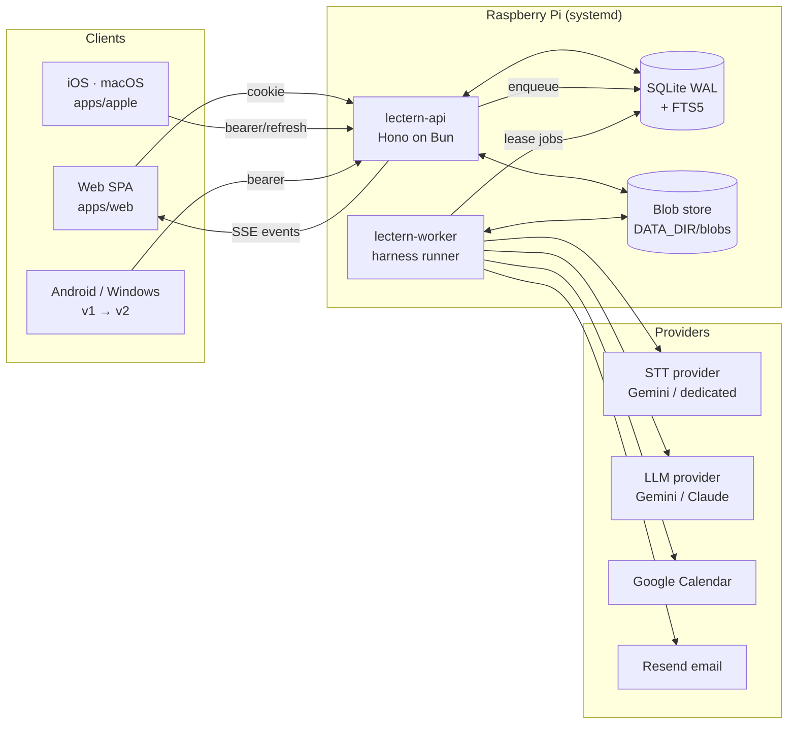
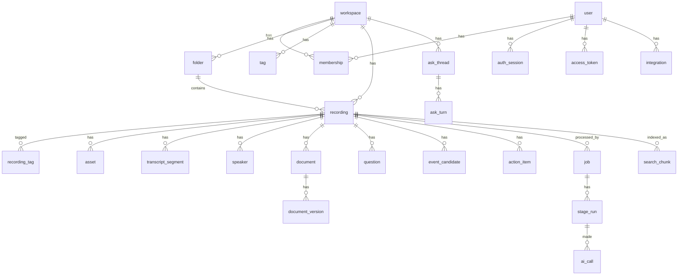

# Lectern v2 — 시스템 아키텍처

> 상태: 설계 초안 (2026-10-19) · 대상 독자: 이 저장소를 이어받는 개발자/에이전트
> 관련 문서: [AI_HARNESS.md](AI_HARNESS.md) (AI 파이프라인 상세) · [ROADMAP.md](ROADMAP.md) (결정 사항·실행 계획)

Lectern을 "대학 강의 녹음 → 마크다운 요약" 앱에서 **녹음(+참고 PDF) → 고밀도 구조화 문서** 플랫폼으로 바꾼다. 대상은 강의, 회의, 세미나, 인터뷰, 1:1, 통화처럼 말로 진행되고 문서로 남겨야 하는 모든 상황이다.

## 1. 목표와 비목표

**목표**
- 어떤 도메인의 녹음이든 **일관된 형식의 문서**(강의 노트, 회의록, 세미나 요약, 인터뷰 기록)로 만든다. 문서의 모든 주장은 원문 구간(타임스탬프)이나 PDF 페이지로 되짚어 갈 수 있어야 한다.
- 녹음 + PDF 업로드, 폴더·태그·워크스페이스 자동 분류, 일괄 정리를 **키보드만으로도 빠르게** 할 수 있게 한다.
- 전사(Transcript)와 오디오 타임라인을 동기화하고, 일정 자동 추출과 캘린더 연동을 제공한다.
- **물어보기**: 노트 하나("이 노트에 물어보기")나 폴더·워크스페이스 전체("전반적으로 물어보기")에 질문하면, 노트에서만 근거를 찾아 출처를 인용해 답한다([§12](#12-검색물어보기), [ADR-0009](../adr/0009-ask-rag.md)).
- AI 처리는 **재개 가능하고 검증되며 비용이 측정되는** 파이프라인으로 돌린다([AI_HARNESS.md](AI_HARNESS.md)).
- 상용 서비스 수준의 계정·권한·쿼터·공유·어드민, 그리고 언제든 인계 가능한 코드·문서 구조를 갖춘다.

**비목표 (v2 범위 밖, [ROADMAP.md](ROADMAP.md#보류-목록)의 보류 목록 참고)**
- 서버 실시간(스트리밍) 전사, 결제 연동, Postgres 전환. (iOS 네이티브 앱은 [ADR-0008](../adr/0008-apple-native-first-class.md)로 범위에 들어왔다. 녹음 중 자막은 기기에서 만든다.)
- 복습 기능(질문 카드, Active Recall, 간격 반복). 범용 노트 앱에 맞지 않아 뺐다. 필요한 질문은 물어보기가 그때그때 만든다([ADR-0009](../adr/0009-ask-rag.md)). 벡터 검색은 물어보기와 함께 범위에 들어왔다.

## 2. 현재 상태 (2026-10-19, `main` = `04394e5`)

### 2.1 구성

| 영역 | 위치 | 현황 |
|---|---|---|
| API + 웹 | `apps/server/src/index.ts` (약 2,900줄) | Bun.serve 하나와 `if` 체인 라우터. 인증, 강의 CRUD, 업로드, SSE, 관리자 API, CD 웹훅이 한 파일에 있다 |
| DB | `apps/server/src/db.ts` (약 1,700줄) | `bun:sqlite`(WAL). 테이블: `users`, `sessions`(로그인), `lectures`, `system_settings`, `audit_logs`, `email_verifications`, `deleted_sources`. 마이그레이션은 `PRAGMA table_info`로 컬럼을 확인해 `ALTER`하는 방식 |
| 웹 UI | `apps/server/src/ui.ts` (약 6,500줄) | 앱, 공유 페이지, 관리자 페이지 모두 TS 템플릿 문자열. 스크립트는 `/assets/*.js`로 분리(CSP `script-src 'self'`) |
| AI | `packages/core/src/gemini.ts` | 오디오 → Gemini File API → **한 번의 호출로 Markdown 생성**. 타임스탬프는 Markdown 안의 `[MM:SS]` 텍스트뿐이고 구조화 데이터·전사·검증은 없다 |
| 작업 | `apps/server/src/jobs.ts` | 인메모리 큐(분석 2, 압축 1 동시 실행). 재시작하면 `status='processing'`인 행을 다시 큐에 넣는다 |
| 저장소 | `apps/server/src/storage.ts` | 로컬 디스크 `DATA_DIR/uploads`, AAC 압축, 휴지통, 보존 정책 |
| 운영 | `apps/server/src/ops.ts` | 유지보수(만료 정리, 백업, WAL), CD(정확한 SHA 배포, 사전 부팅 점검, 롤백) |
| 네이티브 | `apps/macos` (단일 `main.swift` 약 1,800줄), `apps/android`, `apps/windows`, `apps/ios`(빌드 안 되는 스텁) | 모두 v1 API(`/api/lectures`, `/api/ingest/shortcut`) 사용 |
| 배포 | Raspberry Pi 5 (aarch64), systemd `lectern.service`, Cloudflare 경유 `lectern.qucord.com` | GitHub Actions → CD 웹훅 → 사전 점검 → 재시작 |

**v1 API 목록**: `POST /api/auth/{login,logout,register,send-code,reset-password,password,rotate-token}`, `GET /api/auth/me`, `GET|POST /api/lectures`, `POST /api/lectures/{ingest,cleanup}`, `GET|PUT|DELETE /api/lectures/:id`, `/:id/{audio,markdown,visibility,retry}`, `POST /api/ingest/shortcut`, `GET /api/events`(SSE), `GET /s/:token`, `/api/admin/*`(overview, users, settings, ops, storage, lectures, audit, maintenance), `POST /api/cd/deploy`, `GET /api/health`.

### 2.2 유지할 것 (이미 검증된 결정)
- 비밀번호 저장(scrypt, `timingSafeEqual`), 이메일 코드 시도 제한, 인증 rate limit, 관리자 RBAC 검증
- **쿠키 전용 웹 인증**(HttpOnly·Secure·SameSite=Lax), 네이티브는 헤더 토큰
- 엄격한 CSP(`script-src 'self'`, 인라인 핸들러 금지, `data-action` 위임)
- 업로드 MIME 화이트리스트, `nosniff`, 오디오는 확장자 기준 MIME으로 서빙
- 저장소 운영: 압축(원본 아카이브는 하드링크), 휴지통(7일), 보존 정책, `VACUUM INTO` 백업
- CD: 정확한 SHA 배포, 사전 부팅 점검(`preflight.ts`), 실패 시 롤백, 우아한 종료
- Linear 스타일 관리자 콘솔의 정보 구조(보기 단위, 상세 패널, ⌘K)

### 2.3 걷어낼 부채
| 부채 | 대체 |
|---|---|
| `index.ts`의 `if` 체인 라우터 | Hono 라우터 + 모듈별 라우트, zod 검증, OpenAPI |
| `ui.ts` 템플릿 문자열 UI | `apps/web` React SPA(타입 검사·린트 가능) |
| 인메모리 작업 큐 | SQLite 기반 영속 큐 + 별도 워커 프로세스 |
| 단일 호출 Markdown 생성 | 단계형 하네스(전사 → 구조화 JSON → 추출 → 검증) |
| `PRAGMA table_info` 마이그레이션 | 버전 관리되는 SQL 마이그레이션(Drizzle) |
| 운영 코드 안의 `test_`/`bun-test` 분기 | 테스트 샌드박스(이미 도입한 preload)로 일원화하고 분기 삭제 |
| 하드코딩된 `/home/eunhhu/...` 경로 | 환경 변수 + 설정 모듈 |
| 길게 사는 `lct_` API 토큰(평문 저장) | 해시 저장, 범위 지정 PAT, 네이티브는 refresh token |

## 3. 전체 구조



- **API와 워커를 분리한다.** ffmpeg와 AI 호출은 워커에서만 돌기 때문에 웹 응답 지연에 영향을 주지 않는다. 워커가 재시작되거나 죽어도 웹은 계속 동작한다. 둘은 같은 SQLite와 Blob 저장소를 공유하고, 진행 이벤트는 DB의 `job_events`를 통해 API의 SSE로 전달된다(같은 호스트라 폴링 간격 1초 이내).
- **단일 노드를 전제로 하되 이식성은 확보한다.** Pi 한 대에서 SQLite + 로컬 디스크로 운영한다. 저장소는 `BlobStore` 인터페이스(로컬 → S3/R2), DB는 Drizzle(SQLite → Postgres) 뒤에 두어 이전 비용을 낮춘다([확장 경로](#15-확장-경로)).

## 4. 모노레포 레이아웃

```
apps/
  server/        # HTTP API (Hono). systemd ExecStart 경로 유지를 위해 이름 그대로 둔다
  worker/        # 작업 러너: harness 단계, 압축, 유지보수, 리마인더, 캘린더 동기화
  web/           # React SPA (Bun 번들러) → 정적 자산을 server가 서빙
  macos/ android/ windows/ ios/
packages/
  domain/        # zod 스키마 = 단일 진실 공급원 (엔티티, API DTO, 이벤트, 템플릿 스키마)
  db/            # Drizzle 스키마 + SQL 마이그레이션 + 리포지토리
  harness/       # AI 파이프라인: 단계, 공급자 어댑터, 프롬프트, 템플릿, 검증기, 평가(eval)
  media/         # ffmpeg/ffprobe 래퍼, VAD, 청크 분할, 시간 맵
  design-tokens/ # tokens.json(DTCG) → CSS 변수 / Swift / Kotlin 생성
  ui/            # React 컴포넌트 (React Aria Components + 토큰)
  config/        # 환경 변수 스키마(zod), 기본값, 경로
docs/
  v2/            # 이 설계 문서들
  adr/           # 아키텍처 결정 기록 (0001-...)
  runbooks/      # 배포·롤백·백업 복원·시크릿 교체·장애 대응
DESIGN.md        # 디자인 시스템 (P0 산출물)
AGENTS.md        # 사람/AI 에이전트 공통 작업 규칙 (CLAUDE.md는 이 파일을 가리키게)
```

**의존 방향**: `apps/*` → `packages/{harness,db,media,ui}` → `packages/domain` → (없음). `packages/domain`은 런타임 의존성이 zod뿐이고 다른 패키지를 import하지 않는다. 그래야 웹·워커·네이티브 코드 생성이 같은 스키마를 공유하며 병렬로 진행될 수 있다([ROADMAP.md](ROADMAP.md#병렬화와-동결-지점)).

## 5. 도메인 / 데이터 모델 v2

### 5.1 명명 규칙
- 녹음 단위는 **`recording`**(UI 표기: "녹음")이라 부른다. 로그인 세션 테이블 `sessions`와 겹치지 않게 하려는 것이다. 녹음 하나에 오디오 파트 여러 개와 PDF가 붙을 수 있다.
- AI가 만든 결과물은 `document`(구조화 문서), `transcript`(전사), `event_candidate`, `action_item`으로 나눈다. `question`은 계약에 남아 있지만 새 녹음에는 만들지 않는다(폐기 예정, ADR-0009). 물어보기의 대화는 `ask_thread`·`ask_turn`, 검색 색인은 `search_chunk`다.
- **모든 v2 테이블에 `workspace_id`를 둔다.** 권한 검사는 P2부터 워크스페이스 단위로 하고, 사용자마다 개인 워크스페이스를 자동으로 만든다. 팀 기능(초대·공유 UI)은 나중에 붙여도 되지만 컬럼은 처음부터 있어야 한다.
- ID는 UUIDv7(시간 정렬)을 텍스트로 저장하고, 시각은 ISO-8601 UTC로 저장한다. 사용자 시간대는 `users.timezone`에 둔다.

### 5.2 엔티티



| 테이블 | 핵심 컬럼 | 비고 |
|---|---|---|
| `workspace` | id, name, kind(`personal`/`team`), plan, settings_json | 사용자마다 personal 하나 |
| `membership` | workspace_id, user_id, role(`owner`/`admin`/`member`/`viewer`) | 시스템 관리자(`users.role`)와 별개 |
| `folder` | id, workspace_id, parent_id, name, sort_key | 계층형. "과목", "프로젝트" 같은 용도 |
| `tag` / `recording_tag` | workspace_id, name, color | 자동 태그는 `source='ai'` |
| `recording` | id, workspace_id, folder_id, title, domain(`lecture`/`meeting`/`seminar`/`interview`/`one_on_one`/`call`/`other`), template_id, language, recorded_at, recorded_at_source(`client`/`media`/`upload`), duration_ms, status, created_by, visibility | 화면의 중심 단위 |
| `asset` | id, workspace_id, recording_id, kind(`audio`/`audio_normalized`/`audio_compact`/`pdf`/`image`), part_index, blob_key, sha256, bytes, mime, duration_ms, page_count, meta_json | 블롭은 sha256으로 주소 지정 |
| `transcript_segment` | recording_id, idx, start_ms, end_ms (**항상 원본 오디오 시간**), speaker_id, text, confidence, source_chunk | FTS5 가상 테이블 `transcript_fts` |
| `speaker` | recording_id, label(`S1`), display_name, confidence | 사용자가 이름을 바꿀 수 있음 |
| `document` / `document_version` | recording_id, template_id@version, body_json, rendered_md, created_by(`ai`/`user`), base_version | 문서 본문은 JSON 블록(출처 참조 포함)이고 Markdown/HTML은 렌더 결과물이다 |
| `question` | recording_id, kind(`recall`/`issue`/`discussion`), prompt, answer, sources_json(segment ids, pdf pages), difficulty | **폐기 예정**(ADR-0009). 새 녹음에는 만들지 않는다 |
| `event_candidate` | recording_id, kind(`deadline`/`exam`/`meeting`/`task`/`other`), title, start_at, end_at, all_day, tz, raw_expression, confidence, evidence_json, status(`suggested`/`accepted`/`dismissed`/`synced`) | 캘린더 제안함 |
| `action_item` | recording_id, text, owner_name, due_at, status, evidence_json | 회의록 할 일 |
| `share_link` | workspace_id, target(recording/document), token_hash, scope, expires_at, password_hash | 링크 공유 |
| `job` / `stage_run` / `artifact` / `ai_call` | [AI_HARNESS.md §4](AI_HARNESS.md#4-실행-엔진-영속-작업-큐) | 하네스 상태와 비용 원장 |
| `auth_session` | (현 `sessions`를 확장) device_name, user_agent, ip_hash, last_seen_at, refresh_hash | 기기 관리 |
| `access_token` | user_id, name, prefix, token_hash, scopes, expires_at, last_used_at | 개인 액세스 토큰(PAT) |
| `integration` | user_id, provider(`google`), scopes, token_enc, calendar_id, status | 토큰은 암호화 저장 |
| `usage_ledger` | workspace_id, period, audio_ms, ai_cost_microusd, storage_bytes | 쿼터 집행 |
| `search_chunk` (+ FTS5 `search_chunk_fts`, `search_chunk_fts_vocab`) | workspace_id, recording_id, kind(`transcript`/`document`/`pdf_page`), locator, text, content_sha256, 출처(세그먼트 범위·시각·`spans_json` / document·block·`sources_json` / asset·page) | 검색·물어보기 조각. 발행된 전사·문서에서 다시 만들 수 있다([§12](#12-검색물어보기)) |
| `search_embedding` | workspace_id, content_sha256, model, dim, vector(int8), scale | 내용 해시 단위라 같은 글은 한 번만 임베딩 |
| `ask_thread` / `ask_turn` | 스레드: workspace_id, user_id, scope_json. 턴: question, answer, citations_json, outcome, evidence_json, cache_key, 토큰·비용 | 물어보기 대화. 만든 사람만 본다 |
| `audit_log` | (현행 유지) + workspace_id | |

### 5.3 기존 데이터 이전 (`lectures` → v2)
- 강의 하나는 `recording`(domain=`lecture`) + `asset`(오디오) + `document`(template=`legacy-markdown@1`, `rendered_md`에 기존 Markdown)로 옮긴다. 공유 토큰과 공개 여부, `md_source_path` 아카이브 연결도 그대로 옮긴다.
- 기존 강의에는 전사와 구조화 JSON이 **없다.** 세 가지 선택지 가운데 **기본값은 1번**이다.
  1. 레거시 문서로 두고 "전사 없음 · 재처리 가능"으로 표시한다. 재처리는 녹음마다 **예상 비용을 보여 준 뒤 사용자가 직접** 실행한다.
  2. 관리자 녹음만 일괄 재처리한다(비용 상한을 둔 관리자 액션).
  3. 전체 백필(권장하지 않음. P2 첫날에 상한 없는 비용이 나간다).
- **P1 브리지 기간의 편집 충돌**: P1 동안 v2 하네스가 렌더한 Markdown을 `lectures.markdown`에도 쓴다. 사용자가 기존 UI에서 이 Markdown을 고치면 v2 문서(JSON)와 어긋난다. 규칙은 다음과 같다.
  - 브리지된 강의가 편집되면 v2 문서를 `user_edited`로 표시한다.
  - P2 이전 마이그레이션 때 편집된 Markdown은 `legacy-markdown` 버전으로, AI JSON은 별도 버전으로 **둘 다 보존**하고 최신 버전은 사용자 편집본으로 둔다. 두 버전을 병합하지 않는다.
- 마이그레이션은 v1 테이블을 지우지 않는다. v1 API가 v2 테이블을 읽는 어댑터로 바뀌는 시점(P2 말)까지 두 모델을 함께 유지하고, 완전히 이전된 뒤 v1 테이블을 읽기 전용으로 동결한다.
- **물어보기 v1 브리지가 이미 쓰는 id를 그대로 쓴다**([§12.4](#124-v1-브리지p2-전까지)). 그래야 `search_chunk`·`search_embedding`·`ask_thread`·`ask_turn`을 다시 키잉하지 않는다. 다른 id를 고르면 같은 마이그레이션에서 이 테이블들의 `workspace_id`·`recording_id`도 함께 바꾼다.
  - 개인 워크스페이스 id는 `wsp_<user id>`다(`apps/server/src/ask/workspace.ts`).
  - 녹음 id는 강의 id 그대로다.
  - 레거시 문서 id는 `doc_<lecture id>`이고 버전은 1이다.
  - 과목 폴더 id는 `fld_<sha256(owner, course) 앞 32자>`다.

## 6. API v2

- **Hono on Bun**을 쓰고, 경로는 `/api/v2/...`이다. 라우트는 모듈별 파일(`routes/recordings.ts` 등)로 나누고 요청·응답은 `packages/domain`의 zod 스키마로 검증한다. OpenAPI 문서는 스키마에서 생성하며(`/api/v2/openapi.json`), Swift·Kotlin 클라이언트를 여기서 코드로 생성한다.
- **점진 이행**: 새 Hono 앱을 `fetch` 진입점으로 두고, 처리하지 못한 경로는 기존 라우터로 넘긴다. 엔드포인트를 하나씩 옮기고, v1 경로(`/api/lectures`, `/api/ingest/shortcut`)는 네이티브 클라이언트가 v2로 옮길 때까지 어댑터로 유지한다.
- **공통 규약**
  - 오류는 `{ error: { code, message, details? } }` 하나의 형태로 응답한다. `code`는 기계가 읽는 값(`quota_exceeded`, `not_found` 등)이다.
  - 목록은 커서 페이지네이션(`?cursor=&limit=`)을 쓰고 `next_cursor`를 돌려준다.
  - 변경 요청은 `Idempotency-Key` 헤더를 받는다(업로드·재처리 중복 방지).
  - 동시 편집은 문서 버전의 `If-Match`로 낙관적 잠금한다.
  - 권한은 미들웨어에서 워크스페이스 멤버십과 역할을 확인하고, 리소스 단위 정책 함수(`can(user, 'recording:update', rec)`)를 한곳에 모아 테스트한다.
- **업로드**: 재개 가능한 청크 업로드
  - `POST /uploads`(메타데이터, `recorded_at`, 파트 수) → `PUT /uploads/:id/parts/:n` → `POST /uploads/:id/complete`
  - 파일을 메모리에 버퍼링하지 않고 스트리밍으로 디스크에 쓴다. 250MB 제한을 없애기 위한 것으로, 3시간 WAV를 보내는 Windows 클라이언트가 가장 먼저 필요하다.
  - 오디오와 PDF를 한 번의 업로드 세션으로 묶을 수 있다.
- **업로드 계약에 `recorded_at` 추가**: 클라이언트가 녹음 시작 시각을 보낸다. 없으면 미디어 메타데이터(`creation_time`), 그것도 없으면 업로드 시각을 쓰고, 어디서 왔는지를 `recorded_at_source`에 남긴다. 일정 추출의 상대 날짜 해석이 이 값에 의존한다([AI_HARNESS.md §3.9](AI_HARNESS.md#39-verify--결정적-검증과-1회-수리)).
  - 현재 iOS 단축어(`X-Course`만 보냄)와 Android 타일(메타데이터 없음)은 녹음 시각을 보내지 않는다. 미디어 메타데이터도 없으면 v1 어댑터가 `recorded_at_source=upload`로 표시한다. 같은 강의라도 어느 클라이언트로 올렸느냐에 따라 상대 날짜 일정의 신뢰도가 달라지는 이유가 이것이다. P6에서 클라이언트들이 `recorded_at`을 보내게 한다.
- **실시간 이벤트**: `GET /api/v2/events`(SSE). 녹음 상태, 단계 진행률, 문서 갱신, 일정 제안을 워크스페이스 단위로 보낸다. 재연결할 때는 `Last-Event-ID`로 놓친 이벤트를 다시 보낸다(`job_events` 테이블).
- 주요 리소스: `workspaces`, `folders`, `tags`, `recordings`(+ `:id/transcript`, `:id/documents`, `:id/questions`(폐기 예정), `:id/events`, `:id/action-items`, `:id/reprocess`), `uploads`, `search`, `ask`(스레드, 질문 SSE 스트림, 사용량), `calendar/suggestions`, `integrations/google`, `me`(+ `devices`, `tokens`), `share-links`, `admin/*`.

## 7. 웹 앱 (`apps/web`)

- **스택**: React 19 + TypeScript, TanStack Router(라우팅), TanStack Query(서버 상태), **React Aria Components**(접근성 기본 동작: 포커스, 키보드, 스크린리더, 한국어 IME), CSS Modules + 디자인 토큰 CSS 변수. Bun 번들러로 빌드하고 결과물은 `apps/server`가 정적으로 서빙한다(CSP `script-src 'self'` 유지, 런타임 CSS-in-JS 금지).
  - 선택 이유: 인계와 채용 시장을 생각하면 React가 가장 무난하다. a11y는 React Aria가 Radix보다 깊다(ARIA 패턴, 국제화, 날짜 입력). 이 선택은 [ROADMAP.md](ROADMAP.md#결정-필요-사항) D2로 확정한다.
- **정보 구조**
  - **홈/수신함**: 처리 중인 녹음, 확인할 일정 제안, 최근 문서
  - **라이브러리**: 폴더 트리, 태그, 스마트 보기(필터 저장), 다중 선택과 일괄 이동·태그·삭제, 드래그 앤 드롭
  - **녹음 상세**: 3열(왼쪽 전사 ⇄ 가운데 문서 ⇄ 오른쪽 PDF/물어보기)과 하단 고정 오디오 플레이어
  - **물어보기**: 녹음 상세의 "이 노트에 물어보기" 패널과 전역 "전반적으로 물어보기" 화면(폴더·워크스페이스 범위). 답은 스트리밍으로 보이고, `[c3]` 표지는 출처 칩이 되어 전사 구간·문서 블록·PDF 페이지로 이동한다
  - **일정**: 일정 제안함, 확정된 일정·할 일, 캘린더 연결 상태
  - **설정**: 계정, 기기, 토큰, 연동, 사용량
  - **관리자**: 현 Linear 콘솔을 React로 이식
- **업로드 UX**: 오디오와 PDF를 한꺼번에 끌어다 놓으면 파일명·시각으로 자동으로 짝을 짓는다. 업로드하는 동안 도메인·폴더 추천을 보여 주고(분류 단계 결과로 갱신), 처리 진행은 단계별로 표시한다.
- **전사 동기화**
  - 긴 전사는 TanStack Virtual로 가상 스크롤한다.
  - `requestAnimationFrame`으로 `currentTime`을 읽고, 정렬된 세그먼트 배열에서 이진 탐색으로 현재 구간을 찾아 `aria-current`로 표시한다. 사용자가 스크롤 중이면 자동 스크롤을 멈춘다.
  - 세그먼트를 클릭하거나 Enter를 누르면 해당 구간으로 이동한다.
  - 문서 블록의 출처 칩을 누르면 전사의 해당 구간이 강조되고 그 지점으로 이동한다.
  - 전문 검색은 서버 FTS5로 하고, 결과는 하이라이트 스니펫과 함께 타임스탬프로 바로 이동할 수 있게 한다.
- **PDF 뷰어**: pdf.js(v6 이상, CVE-2024-4367 수정 이후 버전)를 직접 호스팅하고 지연 로드한다. 페이지 앵커를 두어 출처 칩(문서·물어보기)을 누르면 해당 페이지로 이동한다. CSP는 다음과 같다.
  - `worker-src 'self'`(모듈 워커, `blob:` 불필요)
  - `font-src 'self' data:`(또는 `disableFontFace`)
  - WebAssembly 디코더를 쓰려면 `script-src`에 `'wasm-unsafe-eval'`을 추가한다. 추가하지 않으려면 `useWasm: false`로 느린 JS 경로를 쓴다.
  - cMap, 표준 글꼴, wasm 파일도 직접 호스팅한다.
- **접근성 기준 (WCAG 2.2 AA)**
  - 모든 기능을 키보드로 쓸 수 있고, 포커스 링이 보이며, 모달은 포커스를 가두고 닫을 때 원래 위치로 되돌린다.
  - 처리 진행과 토스트는 ARIA live region으로 알린다.
  - 명도 대비는 본문 4.5:1, 큰 글자·UI 3:1 이상이다.
  - `prefers-reduced-motion`을 지키고, 시맨틱 랜드마크와 skip link를 둔다.
  - CI에서 Playwright + axe로 핵심 화면을 검사하고, 릴리스마다 VoiceOver로 수동 점검한다.

## 8. 디자인 시스템 (`DESIGN.md`, P0 산출물)

- **단일 진실 공급원**: `packages/design-tokens/tokens.json`(W3C DTCG 형식)이다. Style Dictionary로 `tokens.css`(웹), `Tokens.swift`(macOS/iOS), `Tokens.kt`(Android)를 생성한다. 손으로 쓴 색상값은 lint로 막는다.
- **DESIGN.md 목차**
  1. 원칙: 밀도 있지만 조용하게, 키보드 우선, 출처가 보이는 AI
  2. 토큰: 색(중립 스케일, 강조색, 상태색, 라이트/다크), 타이포(Pretendard, 모노), 간격(4px 그리드), 반경, 그림자, 모션(지속 시간·이징), z-index
  3. 컴포넌트 명세: 버튼, 입력, 목록 행, 상세 패널, 다이얼로그, 토스트, 명령 팔레트, 탭, 배지, 오디오 플레이어, 전사 세그먼트, 문서 블록, 출처 칩
  4. 패턴: 빈 상태, 로딩 스켈레톤, 오류, 파괴적 작업 확인, 일괄 작업
  5. 접근성 규칙과 점검표
  6. 문구 규칙(한국어 UI 톤)
  7. 플랫폼 대응표(CSS ↔ SwiftUI ↔ Compose)
  8. 참고 원칙(Linear, Vercel Geist, Apple HIG): 화면을 베끼지 않고 원칙만 가져온다
- 현재 관리자 콘솔에서 쓰는 다크/라이트 팔레트와 밀도를 출발점으로 삼는다.

## 9. 네이티브

- **iOS·macOS**: 1급 클라이언트로 만들고 시스템 API를 최대한 쓴다([ADR-0008](../adr/0008-apple-native-first-class.md)). 기능 목록, 구조, 서버 요구, 단계는 [NATIVE.md](NATIVE.md)에 있다.
  - `apps/apple/`에 XcodeGen 프로젝트 하나를 두고, 공유 Swift 패키지 `LecternKit`(OpenAPI 생성 클라이언트, Keychain 인증, 백그라운드 업로드 큐), `RecorderKit`(AVAudioEngine 녹음, 마커, macOS 시스템 오디오 탭), `LecternUI`(SwiftUI + 토큰, 문서·전사·PDF), `LecternIntents`(App Intents)를 iOS·macOS가 함께 쓴다.
  - iOS: Dynamic Island·Live Activity(녹음과 처리 진행), 제어 센터·동작 버튼 녹음, 백그라운드 녹음·업로드, 공유 확장, 문서 스캔, Spotlight·Siri, 위젯, EventKit
  - macOS: `MenuBarExtra` HUD, 시스템 오디오 + 마이크 녹음, 회의 감지, 메인 창(`NavigationSplitView`), 위젯, 로그인 시 실행, Developer ID 공증(D7)과 Sparkle 업데이트
  - 서버 추가: APNs 발송기(Live Activity 원격 업데이트), 기기·활동 토큰 API, 녹음 마커, IETF 호환 재개 가능 업로드, `apple-app-site-association`, Sign in with Apple
  - 접근성: VoiceOver 레이블, 키보드 단축키, Dynamic Type 대응
- **Android / Windows**: P6에서 v2 API와 청크 업로드로 옮긴다. 그 전까지는 v1 어댑터로 계속 동작한다.

## 10. 계정·인증·권한·쿼터·공유

- **로그인 수단**
  - 이메일+비밀번호(현행)와 이메일 OTP
  - **Google 로그인(OIDC)**: 같은 연동에서 캘린더 권한을 점진적으로 추가 동의받는다
  - **Sign in with Apple**: iOS 앱이 App Store에 나가려면 필요하다(심사 지침 4.8: 제3자 로그인을 넣으면 개인정보 보호 수준이 같은 로그인 옵션도 함께 둔다). 이메일 가리기(릴레이 주소)를 지원한다.
  - 패스키(WebAuthn)는 보류
- **세션·기기**: `auth_session`에 기기 이름, UA, 마지막 접속을 기록한다. 설정 화면에서 기기 목록을 보고 개별 로그아웃할 수 있다.
  - 웹: 쿠키 세션을 유지한다.
  - 네이티브: 수명이 짧은 액세스 토큰과 회전하는 refresh token을 쓴다. 기존의 오래 사는 `lct_` 토큰을 대체한다.
- **PAT**: 이름, 범위(`recordings:write`, `recordings:read`), 만료를 둔다. 서버에는 해시만 저장하고 생성 시 한 번만 보여 준다. iOS 단축어와 스크립트 연동에 쓴다.
- **권한**: 시스템 역할(운영자)과 워크스페이스 역할을 분리한다. 정책 함수 하나에 모으고 표 형태 테스트로 검증한다.
- **쿼터**: 플랜별로 저장 용량, 월 오디오 분, 월 AI 비용 상한을 둔다. 녹음을 큐에 넣을 때 예상 비용으로 사전 검사하고, 처리 후 실제 비용을 `usage_ledger`에 기록한다. 결제 연동은 보류한다.
- **공유**: 링크 공유(만료, 비밀번호, 범위: 문서만 / 전사 포함 / 오디오 포함)와 워크스페이스 멤버 초대.
- **개인정보**
  - 데이터 내보내기(zip)와 계정 삭제(30일 유예 후 영구 삭제)를 제공한다.
  - 회의 녹음 동의 안내 문구를 둔다.
  - AI 공급자는 데이터를 학습에 쓰지 않는 유료 계층만 사용한다.

## 11. 캘린더·리마인더

- 추출 단계가 `event_candidate`를 만든다. 근거 구간, 원문 표현, 신뢰도가 함께 저장된다. 기본 정책은 **제안만**이고, 사용자는 일정 제안함에서 한 번에 확정할 수 있다. 워크스페이스 설정으로 "명시적 날짜이면서 신뢰도 0.85 이상이면 자동 등록"을 켤 수 있다.
- **Google Calendar**
  - 앱이 **직접 만든 전용 캘린더**("Lectern")에만 쓴다. 사용자 기본 캘린더는 건드리지 않는다.
    - 권한 범위는 `calendar.app.created`(앱이 만든 보조 캘린더와 그 일정만 관리)를 쓴다. 전체 일정 읽기·쓰기(`calendar.events`)는 요청하지 않는다.
    - 가장 좁은 권한으로 동작하는 설계이고, 중복 방지와 "Lectern이 만든 일정 전부 지우기"가 간단해진다.
  - **중복 방지**
    - 일정 `id`를 직접 정한다: `base32hex(sha256(recording_id + item_id))`를 잘라서 쓴다. Google은 충돌 감지를 보장하지 않으므로 이것만으로는 부족하다.
    - 그래서 `extendedProperties.private.lecternEventId`도 함께 저장하고 이 값으로 조회한다.
    - `iCalUID`는 앱이 만드는 일정에 쓰지 않는다(`events.import`에서만 지정 가능).
  - 일정이 수정·취소되면 동기화하고, 실패하면 재시도 큐로 보낸다. 403·429에는 지터를 섞은 지수 백오프로 대응한다. 할당량은 사용자당 분당 600회다.
  - **검증과 한도**: 미검증 앱은 신규 사용자 100명이 상한이고, "Testing" 상태에서는 refresh token이 7일 뒤 만료된다. 실사용자 대상으로 열기 전에 OAuth 앱 검증이 필요하다([D8](ROADMAP.md#결정-필요-사항)).
- **ICS 구독**: 사용자별 비밀 URL(`/ics/:token.ics`)을 제공한다.
  - 토큰은 128비트 이상의 난수이고, 서버에는 해시만 저장한다. 재발급할 수 있고, 폐기한 토큰에는 404/410으로 응답한다. 로그에서는 토큰을 가린다.
  - 일정마다 안정적인 `UID`를 쓰고, 바뀌면 `SEQUENCE`를 올린다. `ETag`/`Last-Modified`와 `REFRESH-INTERVAL`(RFC 7986) 힌트를 보낸다.
  - **갱신은 구독하는 쪽이 정한다.** Google은 반나절~하루가 걸릴 수 있어서 UI에 "베스트 에포트"로 안내한다. 실시간 동기화가 필요하면 Google 연동을 권한다.
- **리마인더**: 워커가 스케줄러로 이메일(Resend)을 보낸다. 웹 푸시는 보류한다. 할 일과 마감의 기본 알림은 하루 전·1시간 전이고 사용자가 설정할 수 있다.

## 12. 검색·물어보기

결정과 근거, 측정값은 [ADR-0009](../adr/0009-ask-rag.md)에 있다. 코드는 `packages/ask`다(`@lectern/domain`과 `bun:sqlite`에만 의존한다).

### 12.1 색인
- 발행된 전사·문서·PDF를 조각(`search_chunk`)으로 나눈다.
  - 전사 창은 약 350토큰이다. 화자가 바뀌거나 쉬는 곳에서 자르고, 잘린 휴식에서는 반드시 자른다.
  - 문서는 블록 하나가 한 조각이다. 레거시 Markdown은 제목 단위로 나눈다.
  - PDF는 페이지 단위다.
- 조각마다 인용에 필요한 출처(세그먼트 범위와 원본 시각, 블록 id와 그 출처, 페이지)를 함께 둔다. 조각 id는 내용에서 나오므로 다시 색인해도 바뀌지 않은 조각은 그대로 남는다.
- 하네스의 `index` 단계가 `publish` 뒤에 색인한다(AI_HARNESS §3.12). 사용자 문서 수정과 레거시 노트 백필(`job.kind = index`)도 같은 단계를 쓴다. 녹음을 지우면 조각·FTS 행·임베딩을 함께 지운다.
- **FTS5는 `trigram` 대신 코드가 만든 문자 바이그램**을 `unicode61`로 색인한다.
  - trigram은 `시험`, `과제` 같은 두 음절 질의를 찾지 못한다.
  - 바이그램은 공백을 건너 이어 만들기 때문에 `운영모드`와 `운영 모드`가 서로 맞는다.
  - 질의에서는 조사·어미를 떼고 의문사를 버린다.
  - 녹음 20개 이하 범위는 그 조각만 코드에서 BM25로 채점한다.
  - 넓은 범위는 드문 질의어부터 넣고, 순위를 매길 일치 조각이 2만 개를 넘지 않게 흔한 질의어를 뺀다(`fts5vocab`).
  - 한 글자 질의는 `LIKE`로 찾는다.
  - 색인은 contentless이고, 원문은 조각 행에만 있다.
- 형태소 분석기는 보류한다. 다시 볼 신호는 평가에서 바이그램과 벡터로도 재현율이 모자랄 때다.

### 12.2 검색
- **하이브리드**: BM25(바이그램) 상위 40개와 벡터 상위 40개를 RRF(k=60)로 결합한다. 여러 녹음 범위에서는 녹음 하나에서 조각을 최대 3개만 쓴다.
- **벡터**
  - `gemini-embedding-2` 768차원을 int8로 `search_embedding`에 저장한다.
  - 검색은 API 프로세스 안에서 전수 비교한다. 범위가 2만 개 이하면 int8로 정확히 비교하고, 넘으면 부호 비트 해밍으로 후보 400개를 고른 뒤 int8로 다시 채점한다.
  - SQLite 확장을 쓰지 않으므로 Mac 테스트와 Pi 운영이 같은 코드다. 노트 1만 개(조각 40만) 기준 메모리는 38MB이고, 검색은 Pi에서 약 95ms(추정)다.
- 임베딩이 없거나 실패하면 BM25만으로 동작한다.
- `GET /api/v2/search`(검색 화면)도 같은 색인과 범위 필터를 쓴다. 결과는 타임스탬프·블록·페이지로 바로 이동한다.

### 12.3 물어보기
- **범위**: 스레드마다 녹음 하나, 폴더(하위 포함 여부), 워크스페이스 전체 중 하나로 고정한다.
  - 사용자가 읽을 수 있는 녹음 목록을 먼저 만들고, 모든 검색을 `workspace_id`와 그 목록으로 거른다(기본 거부).
  - 남의 `private` 녹음은 역할과 관계없이 빠진다.
  - 물어보기는 `owner`·`admin`·`member`만 쓴다.
- **문맥**
  - 노트 하나가 6,000토큰 이하이면 통째로 넣는다. 그보다 길거나 범위가 넓으면 검색한 조각을 3,500토큰까지 넣는다.
  - 후속 질문에는 직전 답의 인용 조각을 이어서 넣는다.
  - 이전 대화는 최근 3턴, 800토큰까지다.
- **근거가 없으면 모델을 부르지 않는다.** 어떤 조각도 질의어를 충분히 담지 않고 코사인도 낮으면 "모름"으로 답하며 비용은 0이다.
- **인용**
  - 조각은 `[c1]`처럼 짧은 표지로 넣고, 모델은 사실 문장마다 표지를 단다. 모를 때는 `[[모름]]`으로 시작한다.
  - 서버가 결정적으로 검증한다: 준 표지인지, 범위 안인지, 문장과 조각이 얼마나 겹치는지(`supported`/`weak`). 전사 인용은 가장 맞는 세그먼트로 좁힌다.
  - 인용이 하나도 남지 않으면 `unsupported`로 표시한다.
- **에이전트**: 기본은 검색 한 번 + 모델 호출 한 번이다. 폴더·워크스페이스 범위에서만 `search_notes`·`read_more`·`list_items` 도구 루프를 최대 2회 연다.
- **API**: `POST /ask/threads`, `GET /ask/threads[/{id}]`, `DELETE /ask/threads/{id}`, `POST /ask/threads/{id}/turns`(SSE), `GET /ask/usage`. 계약은 `packages/domain/src/api/ask.ts`다.
- **비용**
  - 질문 1회 상한은 $0.02이고, 워크스페이스 월 한도가 있다(기본 $2, ROADMAP D14).
  - 같은 질문과 같은 조각 집합이면 캐시로 답한다(비용 0). 같은 키로 재전송해도 두 번 과금하지 않는다.
  - 예상 비용은 `gemini-3.5-flash-lite` 기준 질문당 약 $0.0018이다(ADR-0009 §8).

### 12.4 v1 브리지(P2 전까지)

v2 테이블이 생기기 전에도 물어보기를 실제 노트에 쓸 수 있도록, 각 사용자의 v1 강의를 노트로 본다(`apps/server/src/ask/legacy.ts`). `LECTERN_ASK=1`일 때만 켜진다.

- **대응**
  - 강의는 녹음이다. 상태 `done`만 검색한다.
  - 강의 Markdown은 `legacy-markdown` 문서다. 인용은 `kind: document`, `block_id: null`, `[MM:SS]`에서 읽은 `start_ms`를 가진다.
  - 과목은 폴더이고, 사용자마다 개인 워크스페이스가 하나 있다. id 규칙은 §5.3에 있다.
- **워크스페이스 id**
  - 스텁 `GET /me`는 고정된 픽스처 개인 워크스페이스 id를 돌려준다. 물어보기 라우트는 그 id를 호출자의 `wsp_<user id>`로 받아들인다.
  - 다른 워크스페이스 id는 403이다. P2에서 `/me`가 실제 id를 돌려주면 이 별칭을 지운다.
- **색인**
  - 강의 노트가 쓰이면(분석 완료, 사용자 편집) `index` 작업을 큐에 넣는다.
  - 유지보수 주기마다 조정한다: 저장된 조각이 지금 Markdown과 다르거나 임베딩이 빠진 강의를 다시 넣고, 강의가 없어진 색인 행을 지운다. 기존 강의 백필도 이 조정으로 된다.
  - 15분 넘게 `running`인 턴은 실패로 정리한다.
- **삭제**
  - 강의를 지우면 그 색인과 노트 범위 스레드를 바로 지운다.
  - 계정을 지우면 개인 워크스페이스의 물어보기 데이터를 모두 지운다.
- **한계**
  - 웹 셸의 녹음·폴더 목록은 아직 픽스처다. 노트 범위 질문에는 실제 강의 id를, 폴더 범위에는 위의 파생 폴더 id를 보내야 한다. 이 id는 v1 `/api/lectures`에서 얻는다.
  - 공유 링크로 보는 사람은 물어보기를 쓸 수 없다.

## 13. 운영(Ops)·DX

- **프로세스**: systemd에서 `lectern.service`(API)와 `lectern-worker.service`(워커)를 따로 돌린다. 워커는 유지보수, 리마인더, 캘린더 동기화도 맡는다(타이머를 따로 두지 않는다).
  - 지금 유닛 파일은 호스트의 `/etc/systemd/system`에만 있고 저장소에는 없다. P0에서 `deploy/systemd/*.service` 템플릿과 `EnvironmentFile` 예시를 저장소에 두고, 적용 런북(`docs/runbooks/host-setup.md`)을 만들어 호스트를 재현할 수 있게 한다. 개인 값(이메일 등)은 템플릿에 넣지 않는다.
- **설정**: `packages/config`에서 zod로 환경 변수를 검증한다. 필수 값이 없으면 부팅에 실패해 사전 점검에서 걸린다.
- **로깅**: JSON 한 줄 로그(`level`, `ts`, `msg`, `request_id`, `job_id`, `stage`, `user_id`)를 쓰고 토큰은 가린다. journald에서 `jq`로 조회한다.
- **헬스**: `/api/health`(살아 있음 + DB·디스크)는 현행대로 두고, `/api/ready`(마이그레이션 완료, 워커 하트비트 60초 이내)를 추가한다. 외부 업타임 모니터를 붙인다.
- **마이그레이션**: Drizzle로 SQL 파일을 생성하고 `schema_migrations`로 관리한다. **CD 사전 점검이 최신 백업 사본에 마이그레이션을 미리 적용해 보고**, 성공해야 재시작한다. 실제 적용 직전에는 자동 백업을 한 번 더 뜬다.
- **CD**: 현행(정확한 SHA, 사전 점검, 롤백)을 유지한다. 워커도 같은 체크아웃을 쓰므로 재시작만 추가한다.
- **테스트**
  - `bun test`: 단위·API 계약(OpenAPI 스냅샷)
  - 하네스 평가(유료, 수동이나 야간 실행): [AI_HARNESS.md §8](AI_HARNESS.md#8-평가eval와-품질-게이트)
  - Playwright e2e + axe
  - 마이그레이션 테스트: 직전 스키마 스냅샷에서 올라오는지 확인
- **로컬 개발**: `bun run dev` 하나로 api, worker, web을 함께 띄운다. 임시 `DATA_DIR`과 시드 데이터(샘플 녹음, 전사 픽스처)를 쓰고, 공급자 호출은 녹화·재생 픽스처로 대체한다.
- **인계 문서**
  - `docs/v2/*`, `docs/adr/*`(결정마다 하나), `docs/runbooks/*`(배포·롤백·백업 복원·시크릿 교체·장애 대응·공급자 장애 시 전환)
  - 환경 변수 레퍼런스(`packages/config`에서 생성)
  - `AGENTS.md`(작업 규칙, 테스트 실행법, 금지 사항)

## 14. 보안·프라이버시

- 기존 보안 수정(CSP, MIME, RBAC, rate limit, 코드 시도 제한)을 회귀 테스트로 고정한 상태로 유지한다.
- 공급자 API 키와 OAuth 토큰은 서버에만 둔다. OAuth 토큰은 앱 키로 AES-GCM 암호화해 DB에 저장한다.
- 공유 링크 토큰, PAT, refresh token은 해시로만 저장한다.
- 오디오와 PDF 같은 사용자 데이터는 워크스페이스 밖으로 새지 않는다. 블롭 접근은 항상 API 권한 검사를 거쳐 서빙한다.
- 운영 시크릿은 systemd `EnvironmentFile`(권한 600)에 두고, 교체 런북을 둔다.
- 오너 계정 기본 비밀번호 이력 문제처럼 공개 저장소 이력에 남은 시크릿은 모두 교체된 것으로 간주한다.

## 15. 확장 경로

| 신호 | 대응 |
|---|---|
| 동시 처리 대기열이 늘 쌓임 | 워커 동시성 상향 → 워커를 두 번째 호스트로 분리(같은 DB에 lease, 또는 Postgres 전환) |
| 디스크 사용률 80% 초과 | `BlobStore`를 S3/R2로 교체(키 체계가 같아 이전이 단순) |
| 쓰기 경합 또는 다중 노드 필요 | Drizzle 대상 DB를 Postgres로 바꾸고 FTS는 `pg_trgm`(또는 바이그램 `tsvector`), 벡터는 `pgvector`로 전환 |
| Pi에서 벡터 검색 p95 > 150ms 또는 워크스페이스 조각 100만 개 초과 | `VectorIndex`를 sqlite-vec(1.0 이후) 또는 ANN 색인으로 교체 |
| 팀 사용자 증가, 결제 필요 | 플랜·결제 연동(Stripe/Toss), 워크스페이스 단위 청구 |
