# Lectern v2 — 결정 사항과 실행 계획

> 상태: 설계 초안 (2026-10-19) · 관련: [ARCHITECTURE.md](ARCHITECTURE.md), [AI_HARNESS.md](AI_HARNESS.md)

## 결정 필요 사항

이 표가 이번 주에 정해야 할 것이다. 나머지 내용은 이 결정들을 전제로 한 계획이다.

| # | 질문 | 권장안 | 늦게 정하면 | 막히는 단계 | 기한 |
|---|---|---|---|---|---|
| **D1** | 전사(STT)를 Gemini 하나로 갈지, 전용 STT를 쓸지 | **P1 평가로 결정.** 후보는 Gemini 3.8 Flash(5~8분 청크), Gemini 3.5 Transcribe, Soniox, ElevenLabs Scribe v2, RTZR(한국어 특화)다. 우리 한국어 녹음 약 1시간으로 CER과 화자 오류를 잰다(전체 비용 몇 달러). 통째로 처리하는 전용 STT는 청크 사이 화자 통합 문제를 없애 준다. 공개된 한국어 정확도 수치는 업체 발표뿐이라 직접 재야 한다 | 화자 단계(`speakers`) 설계를 다시 해야 함 | P1 전사 단계 확정 | P1 3주차 |
| **D2** | 웹 프런트엔드 스택 | **React 19 + React Aria Components + TanStack Router/Query, Bun 번들러** | 웹 작업 시작 불가 | P2 | P0 종료 |
| **D3** | 텍스트 단계(구조화, 추출, 검증) 모델 라우팅 | **현행 Gemini를 기본으로 하고 P1 평가로 결정.** 후보: Gemini Flash 계열, Claude(Sonnet/Haiku/Opus). 비용·품질은 측정으로 정한다 | 시작은 막지 않음(공급자 추상화) | — | P1 종료 |
| **D4** | 호스팅 | **P5까지 Raspberry Pi 단일 노드(SQLite + 로컬 디스크)를 유지**하고 이식성은 인터페이스로 확보한다 | 저장소·DB 선택이 흔들림 | P0 | P0 시작 |
| **D5** | 팀 워크스페이스 범위 | **데이터 모델은 첫날부터 워크스페이스 단위**로 만들고 팀 UI(초대, 공유)는 P5 | 모든 테이블 마이그레이션을 다시 해야 함 | P2 | P0 종료 |
| **D6** | 네이티브 우선순위 | **iOS·macOS를 1급 클라이언트로 만들고 시스템 API를 최대한 쓴다**([ADR-0008](../adr/0008-apple-native-first-class.md), [NATIVE.md](NATIVE.md)). Android·Windows는 v1 어댑터로 유지하다 P6 뒤쪽에 이전 | v1 엔드포인트를 언제까지 유지할지 불명 | P6 | P2 시작 |
| **D7** | Apple Developer ID(연 $99)로 공증 배포 | **예.** 지금은 ad-hoc 서명이라 Gatekeeper에 막히고 빌드마다 마이크 권한이 풀린다 | macOS 배포 품질 | P6 | P5 |
| **D8** | Google OAuth 앱 검증 신청(캘린더 권한, Google 로그인) | **예, P0에 바로 신청.** 범위는 `calendar.app.created`로 최소화하고, Cloud Console에서 민감도 등급을 확인한다. 미검증 앱은 신규 사용자 100명이 상한이고, Testing 상태에서는 refresh token이 7일 뒤 만료된다 | P4 출시 지연 | P4 | P0 1주차 |
| **D9** | 일정 자동 등록 기본값 | **제안만**(사용자가 확정). 자동 등록은 워크스페이스 설정으로 켠다 | — | P4 | P4 |
| **D10** | 결제·플랜 | **보류.** 쿼터는 관리자가 수동으로 정한다 | — | — | — |
| **D11** | 오디오 1시간당 AI 비용 목표 | **2026년 중 1시간당 $0.25 이하(전 단계 포함)**로 시작하고, Gemini Flash 단가가 2배가 되는 2027-01-01 전에 다시 평가한다. 현행 단일 호출은 약 $0.12다([AI_HARNESS.md §6.3](AI_HARNESS.md#63-녹음-1시간당-비용-추정)) | 품질·비용 트레이드오프 판단 기준이 없음 | P1 품질 게이트 | P1 2주차 |
| **D12** | 오류 추적 서비스(Sentry 등) | 선택. 없으면 JSON 로그와 관리자 콘솔로 대응 | — | — | P0 |
| **D13** | 물어보기 답변 모델 | **`gemini-3.5-flash-lite`로 시작하고, 물어보기 평가에 `claude-haiku-5-5`를 넣는다.** 질문당 약 $0.0018 대 $0.0005다. Haiku가 품질 게이트를 통과하면 바꾸되, 그러려면 Anthropic을 개인정보처리방침의 처리 위탁처로 추가해야 한다([ADR-0009 §8](../adr/0009-ask-rag.md)) | 비용이 3.5배인 채로 운영 | — | P2 물어보기 평가 |
| **D14** | 워크스페이스 월 물어보기 한도 기본값 | **$2/월**(Flash-Lite로 약 1,100문항). 질문 1회 상한은 $0.02로 고정한다. 결제가 없는 동안(D10) 관리자가 워크스페이스별로 올린다 | 비용 폭주 또는 과한 제한 | P2 물어보기 | P2 |

**결정 기록**
- 2026-10-19: D2(React + React Aria), D4(Pi 단일 노드 유지), D5(워크스페이스 데이터 모델), D6(macOS 우선)은 권장안대로 채택했다.
- 2026-10-19: D7(Apple Developer ID)과 D8(Google OAuth 검증 신청)은 "예"로 정했다.
- 2026-10-19: D6을 바꿨다. iOS 보류를 풀고 iOS·macOS를 시스템 API(Dynamic Island, Live Activity, 제어 센터, 시스템 오디오, 온디바이스 처리)를 최대한 쓰는 1급 클라이언트로 만든다([ADR-0008](../adr/0008-apple-native-first-class.md)).
- 2026-10-19: 복습 기능(질문 카드, Active Recall, 간격 반복)을 범용 노트 앱에 맞지 않아 뺐다. 대신 "이 노트에 물어보기"와 "전반적으로 물어보기"를 RAG로 넣는다([ADR-0009](../adr/0009-ask-rag.md)). 바이그램 FTS5 + `gemini-embedding-2` 하이브리드 검색, 결정적 인용 검증, 질문 1회 상한과 월 한도를 쓴다. 물어보기 v1은 P2, 확장(PDF·도구 루프)은 P3에 넣는다.
- 미정: D1·D3·D11(P1 평가로 결정), D9(P4), D10(보류), D12, D13(물어보기 평가), D14.

## 전체 일정

- **핵심 경로(P0~P5)는 약 12~18주**로 잡는다. 사람 1명이 에이전트 세션을 병렬로 쓰는 것을 전제로 했고, 불확실성이 크다. 가장 큰 변수는 D1(전사 품질 평가 결과)과 D8(Google 검증 기간)이다.
- 단계 이름 옆의 주차는 순서를 보여 주기 위한 것이다. 약속이 아니다. 각 단계는 **종료 기준을 통과해야 끝난다.**

```mermaid
gantt
  dateFormat  X
  axisFormat  W%s
  section 기반
  P0 기반 정비                 :p0, 0, 2
  section AI
  P1 AI 하네스 v2              :p1, 2, 5
  section 제품
  P2 데이터 모델 v2 + 웹 셸     :p2, 3, 6
  P3 PDF·검색·물어보기 확장     :p3, 8, 3
  P4 캘린더·리마인더            :p4, 10, 3
  P5 계정·멀티테넌시            :p5, 11, 4
  section 클라이언트
  P6 Apple 네이티브(iOS·macOS) :p6, 4, 12
  P6 Android·Windows 이전      :p6b, 13, 3
  section 상시
  P7 하드닝·인계                :p7, 2, 16
```

## 병렬화와 동결 지점

P0이 끝나면 세 작업 흐름이 **독립적으로** 진행된다. 단, 그 전에 `packages/domain`을 동결해야 한다.

- **동결의 뜻**: v2 엔티티와 API DTO의 zod 스키마가 머지되었고, 그 스키마에서 생성한 OpenAPI가 커밋되었으며, v2 엔드포인트가 스텁(501 또는 고정 픽스처)으로 존재하는 상태. 이후 스키마 변경은 하위 호환 추가만 허용하고, 깨는 변경은 ADR을 거친다.
- 작업 흐름
  1. **하네스**(P1): `packages/harness`, `packages/media`, `apps/worker`. 산출물을 v2 테이블과 레거시 `lectures.markdown` 브리지에 쓴다.
  2. **웹**(P2 프런트): `apps/web`, `packages/ui`, `packages/design-tokens`. 스텁과 픽스처로 먼저 만들고, 백엔드가 붙으면 실제 데이터로 바꾼다.
  3. **Apple 네이티브**(P6, P2와 함께 4주차부터): `apps/apple`. 웹처럼 픽스처로 먼저 만들고, OpenAPI 생성 클라이언트·Keychain 인증·백그라운드 업로드 큐부터 시작한다([NATIVE.md §7](NATIVE.md#7-단계와-순서)).
- 같은 파일을 두 흐름이 동시에 고치지 않는다. 경계 파일은 `packages/domain`뿐이고, 여기는 한 흐름만 소유한다.

## 단계별 계획

### P0 — 기반 정비

**목표**: 동작은 바꾸지 않고, v2가 올라설 바닥을 운영에 깐다.

산출물
- 문서 체계: `docs/adr/0001-monorepo-layout.md`부터 시작하는 ADR, `docs/runbooks/*` 골격, `AGENTS.md`
- `packages/config`: 환경 변수 zod 스키마. 하드코딩된 경로를 제거한다(운영 기본값은 systemd에 명시).
- `packages/db`: Drizzle 도입. 현 스키마를 기준(baseline) 마이그레이션으로 삼고, 마이그레이션 러너를 만든다. 적용 전 자동 백업을 뜨고, **CD 사전 점검에서 최신 백업 사본에 먼저 적용해 본다.**
- `apps/server`에 Hono 앱을 장착한다. 처리하지 못한 경로는 기존 라우터로 넘긴다. JSON 로깅과 `request_id`를 붙인다.
- **영속 작업 큐 + `lectern-worker` 프로세스**: 현재의 분석·압축·유지보수 작업을 새 큐로 옮긴다([AI_HARNESS.md §4](AI_HARNESS.md#4-실행-엔진-영속-작업-큐)). systemd 유닛을 추가한다.
- 운영 코드의 `test_`/`bun-test` 분기를 삭제한다(테스트 샌드박스로 대체).
- `DESIGN.md` v1과 `packages/design-tokens`. 생성된 CSS 변수를 현 관리자 콘솔에 먼저 적용해 파이프라인을 증명한다.
- `packages/domain` v2 스키마 초안. 동결은 P0 종료 시점에 한다.
- **즉시 적용할 수정**: 현행 파이프라인의 `gemini-flash-latest` 별칭을 버전 고정 ID(`gemini-3.8-flash`)로 바꾸고 응답의 실제 모델 버전을 기록한다. 이 별칭은 3.5 Flash 폐기 후 자동 우회 상태다.
- (D8 = 예이면) Google OAuth 동의 화면과 검증 신청.
- `deploy/systemd/` 유닛 템플릿(api, worker)과 호스트 재현 런북

종료 기준
- 운영에서 api와 worker가 따로 돈다.
- 처리 중인 단계에서 워커를 `kill -9`해도 재시작 후 이어서 처리된다(자동 테스트).
- 마이그레이션이 CD로 적용되고, 실패하면 롤백된다(사본 리허설 포함).
- 사용자가 보기에 달라진 것이 없다.

### P1 — AI 하네스 v2 (최우선)

**목표**: 전사 → 구조화 → 추출 → 검증 파이프라인이 평가 기준을 통과하고, 새 업로드는 이 경로로 처리된다.

산출물([AI_HARNESS.md](AI_HARNESS.md) 상세)
- `packages/media`: 정규화, 무음·휴식 구간 검출, **시간 맵**, 청크 분할(겹침 포함)
- 전사 단계와 공급자 어댑터(Gemini + 평가용 전용 STT 1~2개), 병합, 화자(`speakers`) 단계
- 분류 단계(도메인, 언어, 제목, 폴더 추천)
- 템플릿 레지스트리 5종: `lecture`, `meeting`, `seminar`, `interview`, `general`. 템플릿마다 버전 관리되는 JSON 스키마와 결정적 렌더러를 둔다.
- 구조화 단계, 추출 단계(일정, 할 일, 결정), 검증과 1회 수리. 질문 추출은 기본으로 끈다([ADR-0009](../adr/0009-ask-rag.md))
- `index` 단계(`publish` 뒤 청킹·FTS·임베딩, [AI_HARNESS.md §3.12](AI_HARNESS.md#312-index--검색-색인))와 레거시 노트 색인 백필(배치 임베딩)
- 산출물 메모이제이션(프롬프트·템플릿·모델 해시를 키에 포함), `ai_call` 비용 원장
- 평가 세트 v0(익명화한 녹음 10건 이상: 강의 4, 회의 3, 세미나·인터뷰 3, 한국어 위주, 영어 2건 이상)과 `bun run harness eval` 리포트
  - 주석은 사람 1명이 2~4일 걸린다(교정 전사 Markdown + CSV). **P1 1주차에 담당자를 정한다.** 화자 동의를 받지 못한 녹음은 제외한다.
  - 녹음마다 물어보기 질문 5~8개와 정답 근거를 함께 단다(약 반나절 추가, 20%는 답 없는 질문).
- 관리자 "작업" 보기에 단계 타임라인과 비용 표시
- **브리지**: P2 전까지 기존 UI가 계속 동작하도록 렌더된 Markdown을 `lectures.markdown`에도 쓴다. 사용자가 브리지된 Markdown을 편집하면 v2 문서를 `user_edited`로 표시하고, 마이그레이션 때 두 버전을 모두 보존한다([ARCHITECTURE.md §5.3](ARCHITECTURE.md#53-기존-데이터-이전-lectures--v2)).

종료 기준(평가 세트 기준. 첫 측정 후 수치를 확정한다)
- 스키마 유효율 100%(수리 포함), 근거 연결률(출처 세그먼트가 존재하고 인용이 일치) 95% 이상
- 주석 단 일정의 날짜 정확도 90% 이상, 과추출(근거 없는 일정) 5% 이하
- 한국어 CER은 기준선 대비 악화가 없거나 D1에서 정한 목표치
- 오디오 1시간당 비용이 D11 목표 이하, 처리 시간 p95가 오디오 길이의 0.5배 이하
- 장애 주입(공급자 5xx, 타임아웃, 워커 강제 종료) 시 자동 복구되거나 재시도 가능한 오류 상태로 끝나야 하며, 영원히 "처리 중"인 녹음이 없어야 한다.

### P2 — 데이터 모델 v2 + 웹 셸

**목표**: 새 웹 앱이 기존 UI를 대체하고, v1 클라이언트도 계속 동작한다.

산출물
- v2 테이블과 `lectures` → v2 이전 마이그레이션([ARCHITECTURE.md §5.3](ARCHITECTURE.md#53-기존-데이터-이전-lectures--v2)). 기본은 레거시 문서이고, 재처리는 비용을 보여 준 뒤 사용자가 선택한다.
- API v2: recordings, uploads(**재개 가능한 청크 업로드**, `recorded_at` 포함), transcript, documents(버전, `If-Match`), folders, tags, 기본 검색, SSE(`Last-Event-ID`). OpenAPI와 계약 테스트.
- `apps/web`
  - 라이브러리: 폴더, 태그, 스마트 보기, 다중 선택 일괄 작업, 드래그 앤 드롭
  - 녹음 상세: 전사 동기화, 문서(출처 칩), 오디오 플레이어
  - 오디오+PDF 동시 업로드와 자동 짝짓기
  - ⌘K, 키보드 내비게이션
- v1 어댑터: `/api/lectures`, `/api/ingest/shortcut`이 v2 테이블을 읽고 쓰게 한다.
- **물어보기 v1**([ADR-0009](../adr/0009-ask-rag.md), 백엔드 골격은 `packages/ask`)
  - API: `/ask/threads`, 질문 SSE 스트림, `/ask/usage`
  - 웹: 녹음 상세의 "이 노트에 물어보기" 패널과 "전반적으로 물어보기" 화면. 출처 칩은 전사 구간·문서 블록으로 이동한다.
  - 하이브리드 검색(바이그램 BM25 + 벡터), 근거 없으면 모델 호출 생략, 같은 질문 캐시, 질문 1회 상한과 월 한도(D14)
  - `GET /search`도 같은 색인을 쓴다.
  - Gemini 스트리밍·임베딩 어댑터, `ai_call` 기록, 녹음 삭제 시 색인·스레드 정리
- a11y 자동 검사(Playwright + axe)를 CI에 넣는다.

종료 기준
- 운영 백업 사본으로 마이그레이션을 리허설해 데이터 무손실을 확인한다(건수와 체크섬).
- 기존 macOS, Android, Windows 클라이언트가 계약 테스트를 통과한다.
- 핵심 화면 axe 위반 0건, 키보드만으로 업로드부터 문서 확인까지 가능하다.
- 기존 `ui.ts` 앱 화면을 제거한다(공유 페이지는 v2 렌더러로 교체).
- 물어보기 평가([ADR-0009 §10](../adr/0009-ask-rag.md)):
  - 검색 재현율@12 0.85 이상, 인용 정밀도 0.90 이상
  - `unsupported` 5% 이하, 답 없는 질문의 오답률 10% 이하
  - 질문당 비용 p95가 상한 이하
- 범위 표 테스트에서 다른 워크스페이스와 남의 비공개 노트 조각이 한 번도 나오지 않는다.

### P3 — PDF·검색·물어보기 확장

산출물
- PDF 처리(텍스트 레이어 추출, 스캔본 감지와 비용 경고), 전사 ↔ 페이지 정렬
- pdf.js 뷰어(직접 호스팅, CSP 호환)
- PDF 페이지 색인과 물어보기의 페이지 인용, 출처 페이지·구간 이동
- 물어보기 도구 루프(`search_notes`, `read_more`, `list_items`). 폴더·워크스페이스 범위에서만 최대 2회
- 전역 검색 UI(전사, 문서, PDF). 같은 하이브리드 색인을 쓴다.
- 복습 보기(질문 카드)는 만들지 않는다([ADR-0009](../adr/0009-ask-rag.md)). 질문이 필요하면 물어보기가 그때 만든다.

종료 기준
- PDF가 포함된 평가 세트에서 물어보기 인용 정밀도(페이지·구간) 0.90 이상
- 검색 p95 200ms 이하(Pi, 녹음 1,000건 기준)

### P4 — 캘린더·리마인더

산출물
- 일정 제안함(일괄 확정·무시), 사용자별 ICS 구독 URL
- Google Calendar 연동(전용 캘린더, `extendedProperties` 중복 방지, 수정·취소 동기화, 연결 해제 시 정리)
- 이메일 리마인더, 자동 등록 설정(D9)
- 물어보기 `list_items` 도구를 일정·할 일에 연결("이번 주 마감 전부" 같은 질문)

종료 기준
- 같은 녹음을 다시 처리하거나 동기화를 다시 돌려도 일정이 중복되지 않는다(테스트).
- 권한 회수와 토큰 만료가 오류 없이 처리되고, 사용자가 재연결 안내를 받는다.

### P5 — 계정·멀티테넌시

산출물
- Google 로그인, Sign in with Apple(App Store 심사 지침 4.8), 기기·세션 관리 화면, PAT(범위·만료·해시), 네이티브용 refresh token
- 워크스페이스 초대·역할, 공유 링크(만료·비밀번호·범위)
- 쿼터와 사용량 화면(`usage_ledger`), 관리자 콘솔 React 이식
- 데이터 내보내기, 계정 삭제

종료 기준
- 권한 정책 표 테스트(역할 × 행동 × 리소스) 전부 통과
- 보안 리뷰(인증, 세션, 공유 링크, 업로드)에서 high 이상 0건
- (Flash 의존 라우팅이면) 2027-01 단가로 라우팅 평가를 다시 돌려 D11 목표를 유지하는지 확인

### P6 — Apple 네이티브 (iOS·macOS)

**목표**: iOS·macOS가 시스템 표면에서 녹음부터 "문서 준비됨"까지 끝내는 1급 클라이언트가 된다. 세부 계획은 [NATIVE.md](NATIVE.md)다.

산출물
- N0(지금): macOS 토큰을 `UserDefaults`에서 Keychain으로 옮긴다.
- N1 기반: `apps/apple` XcodeGen 프로젝트, `LecternKit`(OpenAPI 생성 클라이언트, Keychain, 백그라운드·재개 가능 업로드 큐), `RecorderKit`, `LecternUI`(토큰), `LecternIntents`, CI의 iOS·macOS 빌드
- N2 iOS 녹음: `AudioRecordingIntent` + 녹음 Live Activity/Dynamic Island(타이머, 일시정지, 마커) + 제어 센터·동작 버튼 + 백그라운드 녹음 + 공유 확장 + 네이티브 문서 리더, TestFlight 배포
- N3 macOS 재작성: 시스템 오디오 + 마이크 녹음, 회의 감지, `MenuBarExtra`, 메인 창, 로그인 시 실행, Sparkle, Developer ID 공증(D7)
- N4 시스템 표면: 처리 진행 Live Activity(APNs 원격 업데이트, push-to-start), Spotlight·Siri·위젯, 유니버설 링크, Handoff, EventKit 일정 등록(P4와 함께)
- N5 온디바이스(평가 게이트): `SpeechTranscriber` 자막, Vision OCR, Foundation Models 제안
- 서버: APNs 발송기, 기기·활동 토큰 API, 녹음 마커, `apple-app-site-association`(모두 하위 호환 추가)
- Android·Windows를 v2와 청크 업로드로 이전
- v1 엔드포인트 폐기 일정 공지와 차단(사용 로그로 확인한 뒤)

종료 기준
- 각 클라이언트가 v2 계약 테스트를 통과하고, 녹음 → 업로드 → 문서 확인 전 과정을 수동으로 점검한다.
- iOS: 잠금 화면에서 시작한 3시간 녹음이 화면을 끈 채로 끝까지 녹음·업로드되고, 앱을 열지 않고 Dynamic Island에서 "문서 준비됨"을 받는다.
- macOS: 회의 앱 소리와 마이크를 함께 녹음하고, 업데이트 뒤에도 마이크·시스템 오디오 권한이 유지된다.
- VoiceOver로 녹음 시작부터 문서 확인까지 할 수 있다.
- App Store 공개는 P5(Sign in with Apple, 앱 내 계정 삭제) 뒤에 한다. 그 전에는 TestFlight로 배포한다.

### P7 — 하드닝·인계 (상시 + 마무리)

- Pi 부하 시험: 동시 업로드 N건, 3시간 녹음, 디스크 90% 시나리오
- 백업 복원 리허설, 공급자 장애 시 전환 리허설
- a11y 수동 감사(VoiceOver, 키보드), 성능 예산(웹 초기 로드, 전사 스크롤)
- 인계 점검표: 처음 온 사람이 `AGENTS.md`와 런북만으로 로컬 실행, 테스트, 배포, 롤백을 할 수 있어야 한다.

## 운영 전환 계획

1. P0: 동작은 같다. 워커만 분리한다.
2. P1: 기능 플래그로 새 업로드만 v2 하네스로 처리한다. 결과는 브리지로 기존 UI에 보인다. 문제가 생기면 플래그로 즉시 레거시 경로로 되돌린다.
3. P2: 마이그레이션(백업 → 사본 리허설 → 적용)을 한 뒤 웹 v2로 전환한다. 기존 공유 링크(`/s/:token`)는 리다이렉트로 유지한다.
4. P6: v1 엔드포인트 사용량이 0이 되거나 공지 기간이 끝나면 차단한다.

## 리스크

| 리스크 | 영향 | 대응 |
|---|---|---|
| 한국어 화자 분리·타임스탬프 품질 부족 | 전사 동기화와 근거 연결 품질 저하 | P1 평가에서 공급자를 비교하고, 청크 겹침과 정렬을 적용하고, 화자 이름은 사용자가 수정할 수 있게 한다 |
| AI 비용 초과 | 운영비, 쿼터 설계 실패 | 단계별 비용 원장, 큐 투입 전 예상 비용, 작업별 예산 상한, 재전사 없는 재생성 |
| Pi 처리 용량(ffmpeg, 동시 업로드) | 대기열 적체 | 워커 동시성 상한, 단계별 큐, 확장 경로(워커 분리) |
| Google 검증 지연 | P4 출시 지연 | P0에 신청하고, ICS 구독으로 우회 |
| 범위 확장 | 핵심 경로 지연 | 보류 목록과 트리거로 관리하고, 단계 종료 기준을 엄격히 지킨다 |
| 마이그레이션 데이터 손실 | 사용자 데이터 손상 | 사본 리허설, 건수와 체크섬 검증, v1 테이블을 지우지 않고 동결 |
| 1인 유지보수(버스 팩터) | 인계 불가 | ADR, 런북, `AGENTS.md`, 계약 테스트 |
| 물어보기 비용 증가·남용 | 운영비 | 질문 1회 상한, 워크스페이스 월 한도, 근거 없으면 모델 생략, 캐시, 사용자별 횟수 제한 |
| 근거 없는 답(환각), 범위 밖 조각 노출 | 신뢰 하락, 개인정보 사고 | 기본 거부 범위 필터와 이중 확인, 결정적 인용 검증, `unsupported` 표시, 평가 게이트 |

## 보류 목록

| 항목 | 다시 꺼낼 신호 |
|---|---|
| 한국어 형태소 분석기(검색) | 평가에서 바이그램 + 벡터로도 재현율이 모자람 |
| sqlite-vec·ANN 벡터 색인 | Pi에서 벡터 검색 p95가 150ms 초과, 워크스페이스 조각 100만 개 초과, sqlite-vec 1.0 |
| 로컬 임베딩(EmbeddingGemma 2) | 임베딩 비용이 월 AI 비용의 10%를 넘음 |
| 결제·플랜 연동 | 외부 유료 사용자 요청, 팀 워크스페이스 도입 |
| Postgres 전환 | 다중 노드가 필요하거나 SQLite 쓰기 경합이 관측됨([ARCHITECTURE.md §15](ARCHITECTURE.md#15-확장-경로)) |
| 서버 실시간(스트리밍) 전사 | 기기 자막(NATIVE N5)으로 부족하다는 요구 |
| 웹 푸시 알림, 패스키 | 리마인더 이메일 열람률이 낮거나 보안 요구가 생김 |
| 영어 UI | 해외 사용자 유입 |
